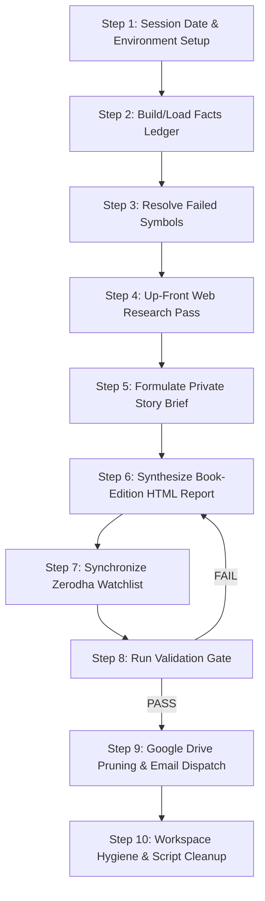

# Indian Equity Market Intelligence & Daily Portfolio Workflow Executor

This workflow governs the deterministic, end-to-end execution of the **Indian Daily Market Intelligence & Watchlist Ingestion Engine**. It synthesizes an institutional-grade, Wikipedia-style daily newsletter, updates watchlist records, enforces data integrity against verified closing prices, and dispatches the briefing via Gmail.

---

## 0. Governing Standards & Non-Negotiable Rules

Before commencing execution, review and adhere strictly to:
- [market_intelligence/SKILL.md](../skills/market_intelligence/SKILL.md)
- [_shared/REPORT_EDITORIAL_STANDARD.md](../skills/_shared/REPORT_EDITORIAL_STANDARD.md) (Binding specification: Pipeline order, Blueprint 7A, Book Edition narrative standard, and Web Research Protocol)
- [_shared/RUN_PROTOCOL.md](../skills/_shared/RUN_PROTOCOL.md) (Binding: run isolation, freshness, cleanup, publication)
- [_shared/REPORT_VOICE.md](../skills/_shared/REPORT_VOICE.md) (Binding: how every heading is explained; banned template phrases)

### Core Non-Negotiables:
1. **Single Source of Truth:** All prices, moving averages (SMA20/50/200), RSI(14), ATR(14), volume multiples, Weinstein stages, breadth figures, and candidate picks (`screen.bull_pick` and `screen.bear_pick`) MUST come directly from `<RUN_DIR>/cache/facts_IN_<date>.json`. Never invent or quote numbers from memory.
2. **Book Edition for Beginners:** Written as an accessible, front-to-back book for someone new to investing. Every financial term is defined with an everyday analogy. Prose carries the reasoning; tables serve as structured evidence.
3. **Mandatory Scaffolding (Blueprint 7A):**
   - `<div class="primer">`: 450+ words opening primer ("Start here") defining core market mechanics.
   - **Lede:** 250–400 words executive summary immediately following the primer.
   - **Section Essays:** Every H2 opens with a 200+ word essay and closes with a 100+ word "What this means for you" paragraph plus a `<p class="chapter-bridge">`. Total prose per H2 must exceed 600 words. Total report prose must exceed 9,000 words (target: 12,000–16,000 words).
   - `<div class="howto">`: 50+ words before every data table (explaining columns and reading one real row aloud).
   - `<p class="takeaway">`: 120+ words after every data table (naming specific tickers, numbers, and key levels).
   - `<div class="casenote" data-symbol="TICKER">`: 80+ words each (target 130–200 words) with numbers and explicit triggers (`if|unless|until|would|trigger|below|above|breaks?|closes?`). Minimum 12 case notes per report.
   - `<div class="example">`: At least 1 worked numeric example walking real rupee arithmetic end-to-end (position sizing, risk, stop-loss, targets).
   - `<div class="triggers">`: At least 6 trigger blocks ("What would change this view" with explicit if/then levels).
   - **Glossary & Methodology:** Explicit `<h2 id="glossary">Glossary</h2>` and a methodology & data-gaps note.
4. **Zero Omissions:** Full 30 breakout alerts (Section 3) and 30 breakdown alerts (Section 4) must be populated. No truncated rows or placeholder comments (`<!-- rest of table -->`).
5. **Deterministic Pre-Send Gate:** `python3 scripts/validate_report.py` MUST output `RESULT: PASS` before any Google Drive pruning or email transmission.

---

## 1.5 Independent Reviewer Gate (mandatory before delivery)

Every report from this workflow must pass the `report_reviewer` skill (`../skills/report_reviewer/SKILL.md`) before it is saved to Drive, published, or emailed.

1. **Run the reviewer passes.** Read `../config/reviewer.json` and `../skills/_shared/REVIEWER_OPERATIONS.md`. Run each pass in the config as a separate fresh agent, using the model set in the config. Do not name a model in this workflow.
2. **Give the reviewer only its inputs:** the report path, `<RUN_DIR>/cache/facts_<MKT>_<date>.json`, `<RUN_DIR>/cache/research_<MKT>_<date>.json`, the snapshots in `<RUN_DIR>/inputs/`, the sibling report if it exists, the three standards in `../skills/_shared/`, and the validator output. Do not pass the Story Brief, your drafts, or your reasoning.
3. **Act on the result.** The reviewer writes `<RUN_DIR>/review_round_<N>.json`. On `REVISE` or `BLOCK`, fix every BLOCK and REVISE finding in the report, re-run `validate_report.py` until it shows `RESULT: PASS`, and send the report back to the reviewer. Address NOTE findings where practical.
4. **Round limit.** Run at most two review rounds. If the report is still not `APPROVE` after round two, do not deliver. Keep `<RUN_DIR>`, and report the open findings to the user.
5. **Delivery condition.** Save to Drive, publish, or send email only when the reviewer returns `APPROVE` and the validator returns `RESULT: PASS`. Record both results in `<RUN_DIR>/manifest.json`.

## 1. Execution Pipeline (Step-by-Step)



---

### Step 1: Session Date, Run Directory & Environment Setup

1. **Determine Session Date (`<YYYY-MM-DD>`):**
   - Check the active NSE trading session date. If running after 16:00 IST on a weekday, use today's date. If running on a weekend, market holiday, or before market close, determine the most recent completed NSE trading session date.
2. **Fresh Run Directory (see `../skills/_shared/RUN_PROTOCOL.md` §1):**
   - Create this run's private directory. Nothing from earlier runs is read; ledgers, research, and prior report HTML are never inputs.
     ```bash
     RUN_DIR="$(mktemp -d "${TMPDIR:-/tmp}/portfolio-<MKT>-<YYYY-MM-DD>-XXXX")" && mkdir -p "$RUN_DIR/cache" "$RUN_DIR/inputs" "$RUN_DIR/work"
     ```
   - Record `RUN_DIR` in `<RUN_DIR>/manifest.json`. The run ends by deleting it (Step 10).
3. **Verify Credentials & Workbooks:**
   - Confirm `.env` exists and contains Gmail SMTP credentials:
     - `GMAIL_USER` (or `GMAIL_ADDRESS` / `EMAIL_USER`)
     - `GMAIL_APP_PASSWORD` (or `EMAIL_PASSWORD`)
     - `GMAIL_RECIPIENT` (default: `rajasekharreddymekala732@gmail.com`)
   - Confirm target paths are accessible:
     - `googledrive/newsletters/`
     - `googledrive/watchlist/Zerodha_Watchlist.xlsx` (or symlink `watchlist/Zerodha_Watchlist.xlsx`)
     - `googledrive/sheets/Zerodha_Holdings.xlsx`
     - `googledrive/shortlist/Zerodha_Shortlist.xlsx`

---

### Step 2: Build the Facts Ledger from Scratch (Zero Prior Bias)

Run the facts ledger builder from scratch to fetch daily market bars, compute indicators, and screen the Nifty 500 universe:

```bash
python3 scripts/market_facts.py --market IN --date <YYYY-MM-DD> --screen nifty500 --run-dir "<RUN_DIR>"
```

> [!NOTE]
> Always generate the facts ledger fresh from live market data for the designated session date. **Never reuse stale prior-session files or copy/rename an older ledger to a new date**, as the validator enforces date honesty against the underlying bar timestamps.

Inspect the ledger output and record key macro parameters:
- `facts["asof"]`: Session date
- `facts["regime"]["label"]`: Verbatim regime label (e.g., `Downtrend`, `Correction`, `Uptrend (broad)`, `Uptrend (narrow breadth)`)
- `facts["regime"]["breadth_pct_above_50dma"]`: Market breadth (% of universe > 50-DMA)
- `facts["regime"]["distribution_days_25"]`: Distribution day count over the past 25 sessions
- `facts["screen"]["bull_pick"]`: Curated 30 Stage 2 breakouts (10 Large, 10 Mid, 10 Small) with qualifiers
- `facts["screen"]["bear_pick"]`: Curated 30 Stage 4 breakdowns (10 Large, 10 Mid, 10 Small) with qualifiers

---

### Step 3: Triage Failed Symbols

Examine the `failures` list in `<RUN_DIR>/cache/facts_IN_<YYYY-MM-DD>.json`:
1. If any symbols failed to resolve (e.g. broker symbol vs Yahoo ticker mismatch):
   - Add mappings to `scripts/config/aliases.json` (e.g. `{"IN": {"BROKER_SYM": "YAHOO_SYM.NS"}}`).
   - Re-test resolution using `python3 scripts/market_facts.py --market IN --date <YYYY-MM-DD> --screen nifty500 --run-dir "<RUN_DIR>" --extra <SYMBOL>`.
2. Ensure no symbol is permitted to output `N/A` for price or stage if historical price data is available.

---

### Step 4: Up-Front Targeted Web Research Pass (duck-duck-go MCP)

Before drafting any report text or HTML, execute the web research pass for all items listed in `facts["research_needs"]` using the `duck-duck-go` MCP tools (`search` + `fetch_content`):

1. **Research Target Scope:**
   - `fii_dii_cash`: NSE/BSE provisional net cash flow for FII/FPI and DII (in ₹ Cr). **Requires dual-source verification.**
   - `fii_index_futures`: FII index futures long contracts, short contracts, and net long/short ratio.
   - `nifty_options`: Nifty 50 and Bank Nifty Put-Call Ratio (PCR), Max Pain strike, Call Resistance Wall, and Put Support Wall. **Requires dual-source verification.**
   - `bulk_block_deals`: Significant bulk/block deals (> ₹10 Cr) on NSE/BSE with buyer/seller names and deal sizes.
   - `delivery_pct`: Security-wise delivery percentages for key breakout setups.
   - `results_calendar`: Upcoming earnings announcements and board meetings for holdings and Top 3 setups over the next 14 days.
   - `promoter_pledge`: Promoter holdings, pledge changes, and SAST disclosures for key setups.
   - `catalyst_news`: Fundamental drivers, earnings growth, order wins, or management guidance behind the Top 3 setups.
2. **Protocol Requirements (Section 6 of Standard):**
   - Format queries with the session date (e.g., `FII DII provisional data 01 Oct 2026 net sold bought crore NSE`).
   - Fetch the actual page content via `fetch_content`; do not rely solely on search snippets.
   - Confirm date stamps match the session date `<YYYY-MM-DD>`.
   - Dual-source confirmation: For `fii_dii_cash` and `nifty_options`, both `source_url` and `confirmed_by` MUST be valid HTTP URLs.
   - If an item cannot be found after `>= 3` distinct queries/sources, record `status: "not_found"` with the list of `queries_tried`.
3. **Persist Research File:**
   - Save the completed record to `<RUN_DIR>/cache/research_IN_<YYYY-MM-DD>.json`.

---

### Step 5: Formulate the Private Story Brief

Formulate a private 6–8 bullet analytical brief to align narrative coherence across all sections:
1. **Regime Verdict:** Verbatim `regime.label` (e.g., `Downtrend`) and implied posture from the standard's regime table.
2. **Breadth & Distribution:** % > 50-DMA and distribution day count.
3. **Sector Rotation:** Quadrant leadership (Leading/Improving) vs laggards (Lagging/Weakening).
4. **Macro & Derivatives:** VIX behavior, Gamma walls (Call/Put strikes), FII cash and index futures posture.
5. **Bull List Thematic Drivers:** Dominant sectors and structural patterns in `screen.bull_pick`.
6. **Bear List Vulnerabilities:** Vulnerable sectors and distribution patterns in `screen.bear_pick`.
7. **Top 3 Tactical Setups:** Three standout setups selected strictly from `screen.bull_pick` with $R:R \ge 3.5:1$.
8. **Primary Portfolio Action:** Clear, unambiguous capital directive (e.g., maintain maximum cash, no new momentum longs, trail stops).

---

### Step 6: Synthesize the Book-Edition HTML Report

Generate the standalone briefing at:
`googledrive/newsletters/Daily_Market_Intelligence_<YYYY-MM-DD>.html`

#### Visual Design & Scaffolding:
- **Typography:** Embed Google Fonts (`Inter`, `Newsreader`, `JetBrains Mono`).
- **Styles:** Embed standard Wikipedia CSS rules + append `.agents/skills/_shared/book_components.css` inside the `<style>` block.
- **Navigation Links:** Every security must feature clickable TradingView and Screener links:
  `<b>{SYMBOL}</b><br><span style="font-size: 11px;"><a href="https://www.tradingview.com/chart/?symbol=NSE%3A{SYMBOL}" target="_blank" style="color: #1d4ed8;">Chart</a> • <a href="https://www.screener.in/company/{SYMBOL}/" target="_blank" style="color: #006600;">Screener</a></span>`

#### Report Structure & Content Checklist:

| Section | Required Structural Components & Content |
|---|---|
| **Header & Infobox** | Floated `table.infobox` with session date, verbatim `regime.label`, India VIX, Breadth % > 50-DMA, Distribution days, FII/DII Net Cash, FII Futures Long/Short ratio. |
| **Primer ("Start here")** | `<div class="primer">`: **450+ words**. Everyday analogies explaining moving averages, Stages 1–4, RSI, ATR, volume expansion, PCR & option walls, stop-loss, and risk/reward. |
| **Lede** | **250–400 words**. Plain-English session verdict, 3 critical data points, and the single primary action. |
| **1. Big Picture & Derivatives Radar** | **600+ words prose**. Indices table, options/derivatives table, macro table. Each table flanked by `<div class="howto">` (50+ words) and `<p class="takeaway">` (120+ words). Worked example (`<div class="example">`). Triggers block (`<div class="triggers">`). Chapter bridge. |
| **2. Sector Rotation Matrix** | **600+ words prose**. 4-Quadrant Sector table (Leading, Weakening, Lagging, Improving). Howto + takeaway. Case notes for top leading and lagging sector proxies. Triggers block. Chapter bridge. |
| **3. The Bull List: Top 30 Breakouts** | **600+ words prose**. Three distinct wikitables: 3.1 Large-Cap (10), 3.2 Mid-Cap (10), 3.3 Small/Micro-Cap (10) strictly matching `screen.bull_pick`. Qualifiers displayed (`confirmed`, `awaiting volume confirmation`, etc.). Howto + takeaway for each table. 3 spotlight case notes (`<div class="casenote">`). Triggers block. |
| **4. The Bear List: Top 30 Breakdowns** | **600+ words prose**. Breakdown wikitable: 30 stocks across Large, Mid, Small tiers strictly matching `screen.bear_pick`. Howto + takeaway. 3 spotlight case notes. Triggers block. |
| **5. Smart Money Radar & Catalysts** | **600+ words prose**. Bulk/Block deals table (> ₹10 Cr) and corporate catalyst table. Howto + takeaway. Pre-earnings risk protocol explained with worked arithmetic. |
| **6. Tactical Playbook & Capital Allocation** | **600+ words prose**. Callout box with Top 3 Setups (selected strictly from Section 3, $R:R \ge 3.5:1$). Entry bands, stop losses, profit targets. Case note for each setup. Worked example of position sizing and portfolio risk. Regime-aligned stance. Triggers block. |
| **7. Watchlist Ingestion & Pipeline Sync** | **600+ words prose**. Rationale for the 1–3 setups advancing into the deep research funnel (`watchlist/Zerodha_Watchlist.xlsx`). Explanation of the upcoming 3-layer underwriting test. |
| **End Matter** | `<h2 id="glossary">Glossary</h2>` defining key terms, Methodology & Data Gaps note, and `<ol class="reflist">` with numbered verified citations. |

---

### Step 7: Synchronize Zerodha Watchlist Workbook

Update `googledrive/watchlist/Zerodha_Watchlist.xlsx` (or `watchlist/Zerodha_Watchlist.xlsx`):
1. Ingest the Top 1–3 standout setups identified in Section 6 into the `Active_Watchlist` sheet in-place.
2. Populate all required columns:
   - `Symbol`: NSE ticker
   - `Company Name`: Official corporate name
   - `Market Cap (Cr)`: Verified market cap
   - `CMP`: Latest closing price from the facts ledger
   - `Status`: `RESEARCH_REQUIRED`
   - `Source Type`: `MARKET_INTELLIGENCE`
   - `Added Date`: Session date (`YYYY-MM-DD`)
   - `Technical Setup`: Weinstein Stage 2 breakout description, key moving averages, RSI, volume multiple
   - `Entry Trigger`: Explicit pivot/entry band
   - `Stop Loss`: Stop-loss level anchored to swing low or 50-DMA
   - `Target`: Base target and measured-move target

---

### Step 8: Pre-Send Deterministic Validation Gate

Execute `scripts/validate_report.py` against the generated HTML report and facts ledger:

```bash
python3 scripts/validate_report.py \
  --report "googledrive/newsletters/Daily_Market_Intelligence_<YYYY-MM-DD>.html" \
  --kind market_intel \
  --facts "<RUN_DIR>/cache/facts_IN_<YYYY-MM-DD>.json"
```

#### Strict Pass Criteria:
- **Total Prose:** $\ge 9,000$ words
- **Per H2 Section Prose:** $\ge 600$ words each
- **Primer:** $\ge 450$ words
- **How-to-Read Blocks:** $\ge 6$ blocks
- **Table Intros / Takeaways:** Intros $\ge 50$ words, takeaways $\ge 120$ words
- **Case Notes:** $\ge 12$ notes, each $\ge 80$ words with numbers and triggers
- **Worked Examples:** $\ge 1$ block with currency math
- **Trigger Blocks:** $\ge 6$ blocks with explicit if/then levels
- **N/A Budget:** $\le 5.0\%$ overall, $\le 25\%$ in any table
- **Candidate Integrity:** Exactly 30 Bull and 30 Bear names matching `screen.bull_pick` and `screen.bear_pick`
- **Price & Stage Fidelity:** CMPs match ledger closes within 1.5%; stages and regime match ledger exactly
- **Research Coverage:** `<RUN_DIR>/cache/research_IN_<YYYY-MM-DD>.json` covers all needs with valid URLs and dual-source confirmation for headline metrics

> [!CAUTION]
> If the validator outputs `FAIL`, you MUST fix the deficiencies in the report HTML and re-run the validator until it outputs `RESULT: PASS`. Never bypass the validator or lower threshold arguments.

---

### Step 9: Google Drive Maintenance & Email Transmission

Only after `validate_report.py` outputs `RESULT: PASS`:

1. **Google Drive Single-Latest Version Lifecycle:**
   - Scan `googledrive/newsletters/` for older versions matching `Daily_Market_Intelligence_*.html` (excluding the newly validated session file).
   - Delete/prune all prior versions so Google Drive maintains strictly only the single latest report showing the current run date.
2. **Automated Email Dispatch:**
   - Dispatch the newsletter to `rajasekharreddymekala732@gmail.com` via `scripts/send_email.py`:

```bash
python3 scripts/send_email.py \
  --subject "📊 Daily Market Pulse | <YYYY-MM-DD> — Nifty <Regime/Status> | 30 Breakouts & 30 Breakdown Alerts" \
  --html-file "googledrive/newsletters/Daily_Market_Intelligence_<YYYY-MM-DD>.html" \
  --recipient "rajasekharreddymekala732@gmail.com"
```

- Verify that SMTP transmission finishes with exit code `0`.

---

### Step 10: Workspace Hygiene & Script Cleanup

1. **Delete Transient Scripts:**
   - Any temporary generator or utility scripts created during this run (e.g. `generate_*.py`, `build_*.py`, `temp_*.py`) must be deleted:
     ```bash
     rm -f scripts/build_*.py scripts/generate_*.py build_full_market_intel.py generate_market_intel.py
     rm -rf scripts/__pycache__/ __pycache__/
     ```
2. **Run Directory Cleanup**
   - Delete `<RUN_DIR>` once artifacts are saved (RUN_PROTOCOL §5).
     ```bash
     rm -rf "<RUN_DIR>"
     ```
3. **Preserve Permanent Infrastructure Whitelist:**
   - `scripts/market_facts.py`
   - `scripts/validate_report.py`
   - `scripts/send_email.py`
   - `scripts/build_dossier_portal.py`
   - `scripts/serve_blogs.py`
   - `scripts/dossier_builder_template.py`
   - `scripts/com.portfolio.blogs.fileserver.plist`
   - `scripts/config/aliases.json`
   - `.agents/`
4. **Verify Clean Tree:** Run `ls scripts/` and confirm only whitelisted files remain.