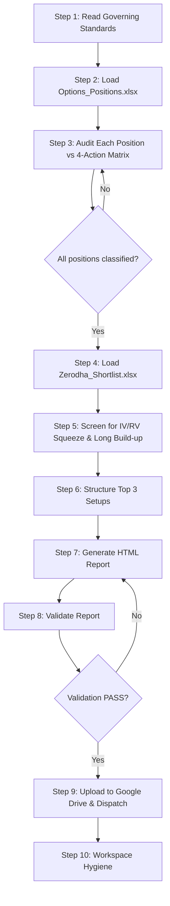

# Indian Options Audit & Setup Structuring Workflow Executor

This workflow is the **Indian Options Position Audit & Setup Structuring Engine**. It performs two distinct but related tasks:

1. **Position Audit**: Audits all current active options positions in `Options_Positions.xlsx` against the 4-action matrix (HOLD, ROLL_UP_OUT, CONVERT_SPREAD, KILL) and recommends actions using the `options_underwriting` skill for the Indian (NSE F&O) portfolio.
2. **Setup Screening**: Screens the shortlisted candidates in `Zerodha_Shortlist.xlsx` for high-conviction options setups with IV/RV squeeze and Long Build-up signals, and structures the Top 3 setups.

This workflow is designed to run **daily at 09:00** (pre-market) to ensure positions are reviewed before the Indian market opens.

---

## 0. Governing Standards & Non-Negotiable Rules

Before executing any step, you MUST read and internalize the following governing documents. These are the **single source of truth** for all underwriting logic, data rules, and report formatting.

### 0.1 Required Skill & Standard Files

| File | Purpose |
|---|---|
| [Indian Options Underwriting Skill](../skills/options_underwriting/SKILL.md) | 4-action matrix, NSE F&O data rules, Long Build-up detection, Strike OI migration, PCR, Bull Call Spread structuring, report format |
| [Report Editorial Standard](../skills/_shared/REPORT_EDITORIAL_STANDARD.md) | HTML report structure, typography, color palette, callout boxes, validation rules |
| [Run Protocol](../skills/_shared/RUN_PROTOCOL.md) | Run isolation, freshness, cleanup, publication |
| [Report Voice](../skills/_shared/REPORT_VOICE.md) | Plain-English explanation of every heading; no template phrases |

### 0.2 Core Non-Negotiables

1. **4-Action Matrix Only**: Every position must be classified into exactly one of: `HOLD`, `ROLL_UP_OUT`, `CONVERT_SPREAD`, or `KILL`. No other actions are permitted.
2. **NSE F&O Data Rules**: IV Percentile, OI data, and PCR must be sourced from NSE F&O. Never estimate or approximate.
3. **Long Build-up Detection**: Large call purchases (not covered calls) with OI building at strikes above current price. PCR declining = bullish positioning.
4. **DTE Constraints**: Bull Call Spreads must be 30–75 DTE. LEAPS must be 180–720 DTE.
5. **Top 3 Setups Only**: The screening phase must produce exactly 3 structured setups, ranked by conviction.
6. **Report Output**: Final report must be written to `googledrive/newsletters/Options_Underwriting_NSE_<YYYY-MM-DD>.html`.
7. **Validation Gate**: The report must pass `python3 scripts/validate_report.py --kind options` before dispatch.
8. **Rupee Arithmetic**: All monetary values must be in INR. Use Indian number formatting (lakh/crore) where appropriate.

---

## 1.5 Independent Reviewer Gate (mandatory before delivery)

Every report from this workflow must pass the `report_reviewer` skill (`../skills/report_reviewer/SKILL.md`) before it is saved to Drive, published, or emailed.

1. **Run the reviewer passes.** Read `../config/reviewer.json` and `../skills/_shared/REVIEWER_OPERATIONS.md`. Run each pass in the config as a separate fresh agent, using the model set in the config. Do not name a model in this workflow.
2. **Give the reviewer only its inputs:** the report path, `<RUN_DIR>/cache/facts_<MKT>_<date>.json`, `<RUN_DIR>/cache/research_<MKT>_<date>.json`, the snapshots in `<RUN_DIR>/inputs/`, the sibling report if it exists, the three standards in `../skills/_shared/`, and the validator output. Do not pass the Story Brief, your drafts, or your reasoning.
3. **Act on the result.** The reviewer writes `<RUN_DIR>/review_round_<N>.json`. On `REVISE` or `BLOCK`, fix every BLOCK and REVISE finding in the report, re-run `validate_report.py` until it shows `RESULT: PASS`, and send the report back to the reviewer. Address NOTE findings where practical.
4. **Round limit.** Run at most two review rounds. If the report is still not `APPROVE` after round two, do not deliver. Keep `<RUN_DIR>`, and report the open findings to the user.
5. **Delivery condition.** Save to Drive, publish, or send email only when the reviewer returns `APPROVE` and the validator returns `RESULT: PASS`. Record both results in `<RUN_DIR>/manifest.json`.

## 1. Execution Pipeline (Step-by-Step)



---

### Step 1: Read Governing Standards

1. Read the full `options_underwriting` skill file.
2. Read the `REPORT_EDITORIAL_STANDARD.md`.
3. Confirm you understand the 4-action matrix, NSE F&O data rules, DTE constraints, and report format.

> [!NOTE]
> Do NOT proceed to Step 2 until you have fully internalized the skill's underwriting logic.

---

### Step 2: Load Options_Positions.xlsx

1. Read `Options_Positions.xlsx` from the portfolio root.
2. Parse all active positions: symbol, contract type (call/put), strike, expiry, quantity, entry price, current P&L.
3. Identify any positions that are expired, assigned, or closed — exclude these from the audit.

```bash
# Verify the file exists and is readable
ls -la Options_Positions.xlsx
```

---

### Step 3: Audit Each Position vs 4-Action Matrix

For **each active position**, perform the following:

1. **Fetch live data**: Current IV, IV Percentile, GEX, UOA, underlying price, DTE remaining, Strike OI, PCR.
2. **Apply the 4-action matrix**:
   - **HOLD**: Position is performing as expected, IV Percentile is favorable, OI migration is supportive.
   - **ROLL_UP_OUT**: Position is underperforming but the thesis is intact. Roll to a higher strike and/or later expiry.
   - **CONVERT_SPREAD**: Position has significant unrealized gain. Convert to a defined-risk spread to lock in profit and reduce delta.
   - **KILL**: Thesis is broken, IV Percentile is extreme, or OI migration is working against the position. Close immediately.
3. **Document the recommendation** for each position with:
   - Action (one of the 4)
   - Rationale (2–3 sentences citing specific data points)
   - If ROLL/CONVERT: specific new strike/expiry
   - If KILL: target exit price and estimated loss

> [!CAUTION]
> Every recommendation MUST cite specific data (IV Percentile value, OI numbers, PCR value). No generic advice.

---

### Step 4: Load Zerodha_Shortlist.xlsx

1. Read `Zerodha_Shortlist.xlsx` from the portfolio root.
2. Parse all shortlisted candidates: symbol, sector, current price, key metrics.
3. These are the candidates for the setup screening phase.

---

### Step 5: Screen for IV/RV Squeeze & Long Build-up

For **each shortlisted candidate**, perform the following:

1. **IV/RV Squeeze Check**:
   - Current IV vs. Realized Volatility (20-day).
   - IV Percentile — look for IV < 30th percentile (compression).
   - RV trending up while IV is flat or declining = squeeze setup.
2. **Long Build-up Check**:
   - Unusual Options Activity: Large call purchases (not covered calls).
   - Strike OI migration: OI building at strikes above current price.
   - PCR (Put-Call Ratio) declining = bullish positioning.
3. **Score each candidate** on conviction (1–10) based on the strength of both signals.

> [!NOTE]
> Use live web search (DuckDuckGo) to verify current IV, RV, OI, and PCR data from NSE F&O. Do NOT rely on stale data.

---

### Step 6: Structure Top 3 Setups

From the screened candidates, select the **Top 3** by conviction score and structure each setup:

1. **Setup Type**: Bull Call Spread (30–75 DTE) or LEAPS (180–720 DTE).
2. **Structure**:
   - Buy strike: ATM or slightly OTM
   - Sell strike: 10–15 points above (for spreads)
   - Expiry: Optimal DTE based on catalyst timeline
   - Position size: Based on account allocation rules
3. **Risk/Reward**:
   - Max loss (premium paid)
   - Max gain (spread width − premium)
   - Breakeven
   - R:R ratio
4. **Catalyst**: What event or trend drives the setup?

---

### Step 7: Generate HTML Report

1. Create the HTML report following the `REPORT_EDITORIAL_STANDARD.md`.
2. Structure:
   - **Header**: Date, "Indian Options Audit & Setup Structuring"
   - **Section 1: Position Audit** — Table of all positions with action, rationale, and specific recommendations
   - **Section 2: Top 3 Setups** — Detailed structure for each setup with risk/reward
   - **Section 3: Market Context** — Brief note on overall IV environment, NSE F&O OI trends, PCR
3. Write to `googledrive/newsletters/Options_Underwriting_NSE_<YYYY-MM-DD>.html`.

```bash
# Verify the output file was created
ls -la googledrive/newsletters/Options_Underwriting_NSE_$(date +%Y-%m-%d).html
```

---

### Step 8: Validate Report

```bash
python3 scripts/validate_report.py --kind options
```

- If `RESULT: PASS` → proceed to Step 9.
- If `RESULT: FAIL` → fix the issues and re-validate. Do NOT dispatch an invalid report.

---

### Step 9: Upload to Google Drive & Dispatch

1. Upload the HTML report to Google Drive (single-latest versioning — replace any existing file with the same name).
2. Send the report via email using `scripts/send_email.py`.

```bash
python3 scripts/send_email.py --report "googledrive/newsletters/Options_Underwriting_NSE_$(date +%Y-%m-%d).html" --subject "Indian Options Audit & Setup Structuring - $(date +%Y-%m-%d)"
```

---

### Step 10: Workspace Hygiene & Cache Pruning

1. Delete any transient scripts or temp files created during execution (`rm -f scripts/build_*.py scripts/generate_*.py` and `rm -rf scripts/__pycache__/`).
2. Run Directory Cleanup: once the validation gate passes and artifacts are saved, delete this run's directory with `rm -rf "<RUN_DIR>"` (RUN_PROTOCOL §5). On failure, keep it and report its path.
3. Preserve the permanent infrastructure whitelist:
   - `scripts/market_facts.py`
   - `scripts/validate_report.py`
   - `scripts/send_email.py`
   - `scripts/build_dossier_portal.py`
   - `scripts/serve_blogs.py`
   - `scripts/dossier_builder_template.py`
   - `scripts/com.portfolio.blogs.fileserver.plist`
   - `scripts/config/aliases.json`
   - `Options_Positions.xlsx`
   - `Zerodha_Shortlist.xlsx`
   - `googledrive/` directory structure

> [!NOTE]
> The workflow is complete when the report is dispatched and the workspace is clean.
