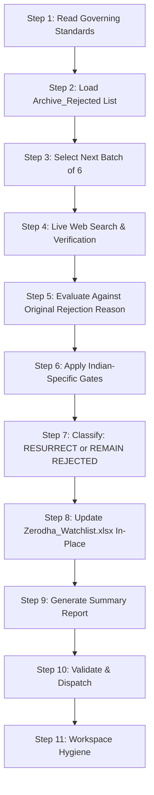

# Indian Reject to Watchlist Workflow Executor

This workflow is the **Indian Archive Resurrection Review Engine**. It processes the next batch of 6 NSE/BSE Archive_Rejected stocks, uses live web search to verify current fundamentals and technical posture against the original rejection reasons, and updates `Zerodha_Watchlist.xlsx` in-place.

This workflow is designed to run **daily at 20:00** (after Indian market close) to review rejected stocks that may have changed their fundamental or technical posture.

---

## 0. Governing Standards & Non-Negotiable Rules

Before executing any step, you MUST read and internalize the following governing documents. These are the **single source of truth** for all underwriting logic, data rules, and report formatting.

### 0.1 Required Skill & Standard Files

| File | Purpose |
|---|---|
| [Archive Resurrection Review Skill](../skills/archive_resurrection_review/SKILL.md) | Resurrection triage criteria, batch processing rules, watchlist update format, 90-day review cycle |
| [Report Editorial Standard](../skills/_shared/REPORT_EDITORIAL_STANDARD.md) | HTML report structure, typography, color palette, callout boxes, validation rules |
| [Run Protocol](../skills/_shared/RUN_PROTOCOL.md) | Run isolation, freshness, cleanup, publication |
| [Report Voice](../skills/_shared/REPORT_VOICE.md) | Plain-English explanation of every heading; no template phrases |

### 0.2 Core Non-Negotiables

1. **Batch Size = 6**: Process exactly 6 Archive_Rejected stocks per run. Do NOT process more or fewer.
2. **Lightweight Triage**: This is a triage, not a full underwriting. Focus on whether the original rejection reason has been invalidated.
3. **Live Web Search**: Use DuckDuckGo web search to verify current fundamentals and technical posture. Do NOT rely on stale data.
4. **Original Rejection Reason**: Each stock must be evaluated against its specific original rejection reason. A stock rejected for weak margins is only resurrected if margins have improved.
5. **NSE/BSE Only**: Only process stocks listed on NSE or BSE.
6. **In-Place Update**: `Zerodha_Watchlist.xlsx` must be updated in-place. Do NOT create a new file.
7. **90-Day Review**: Stocks resurrected to the watchlist are eligible for re-review after 90 days.
8. **Rupee Arithmetic**: All financial figures in INR. Use Indian number formatting (lakh/crore) where appropriate.

---

## 1.5 Independent Reviewer Gate (mandatory before delivery)

Every report from this workflow must pass the `report_reviewer` skill (`../skills/report_reviewer/SKILL.md`) before it is saved to Drive, published, or emailed.

1. **Run the reviewer passes.** Read `../config/reviewer.json` and `../skills/_shared/REVIEWER_OPERATIONS.md`. Run each pass in the config as a separate fresh agent, using the model set in the config. Do not name a model in this workflow.
2. **Give the reviewer only its inputs:** the report path, `<RUN_DIR>/cache/facts_<MKT>_<date>.json`, `<RUN_DIR>/cache/research_<MKT>_<date>.json`, the snapshots in `<RUN_DIR>/inputs/`, the sibling report if it exists, the three standards in `../skills/_shared/`, and the validator output. Do not pass the Story Brief, your drafts, or your reasoning.
3. **Act on the result.** The reviewer writes `<RUN_DIR>/review_round_<N>.json`. On `REVISE` or `BLOCK`, fix every BLOCK and REVISE finding in the report, re-run `validate_report.py` until it shows `RESULT: PASS`, and send the report back to the reviewer. Address NOTE findings where practical.
4. **Round limit.** Run at most two review rounds. If the report is still not `APPROVE` after round two, do not deliver. Keep `<RUN_DIR>`, and report the open findings to the user.
5. **Delivery condition.** Save to Drive, publish, or send email only when the reviewer returns `APPROVE` and the validator returns `RESULT: PASS`. Record both results in `<RUN_DIR>/manifest.json`.

## 1. Execution Pipeline (Step-by-Step)



---

### Step 1: Read Governing Standards

1. Read the full `archive_resurrection_review` skill file.
2. Read the `REPORT_EDITORIAL_STANDARD.md`.
3. Confirm you understand the triage criteria, batch processing rules, and watchlist update format.

> [!NOTE]
> Do NOT proceed to Step 2 until you have fully internalized the skill's triage logic.

---

### Step 2: Load Archive_Rejected List

1. Read the Archive_Rejected list from the portfolio (typically `Zerodha_Archive.xlsx` or the rejected section of the watchlist).
2. Parse all rejected stocks: symbol, original rejection reason, rejection date, key metrics at rejection.
3. Identify stocks that have already been resurrected — exclude these.

```bash
# Verify the archive file exists and is readable
ls -la watchlist/Zerodha_Archive.xlsx
```

---

### Step 3: Select Next Batch of 6

1. From the remaining rejected stocks (not yet resurrected), select the **next 6** in priority order.
2. Priority order is determined by:
   - Time since rejection (longest rejected first)
   - Recent news or catalysts
   - Sector diversification
3. Log the selected batch with symbols and original rejection reasons.

---

### Step 4: Live Web Search & Verification

For **each of the 6 stocks**, perform live web search:

1. **Current Fundamentals**: Latest revenue, margins, FCF, debt, promoter holding.
2. **Technical Posture**: Current price, trend, key levels, volume.
3. **Recent News**: Any material events since rejection (earnings, M&A, regulatory, management changes).
4. **Analyst Consensus**: Current ratings and price targets.

> [!CAUTION]
> Use DuckDuckGo web search extensively for each stock. Verify current data. Do NOT rely on cached or stale information.

---

### Step 5: Evaluate Against Original Rejection Reason

For each stock, compare current state against the original rejection reason:

1. **Was the rejection reason specific?** (e.g., "Operating margin < 15%")
2. **Has that specific reason been invalidated?** (e.g., "Operating margin now 22%")
3. **Are there new positive catalysts?** (e.g., "New capacity expansion, government policy tailwind")
4. **Are there new negative risks?** (e.g., "Promoter pledge increase, regulatory probe")

Document the evaluation with specific data points.

---

### Step 6: Apply Indian-Specific Gates

For each stock, apply the Indian-specific rejection gates:

| Gate | Threshold | Status |
|---|---|---|
| `FAIL_MARGIN` | Operating margin < 15% | PASS/FAIL |
| `FAIL_DEBT` | Debt/Equity > 1.0 | PASS/FAIL |
| `FAIL_PROMOTER_PLEDGE` | Promoter pledge > 10% | PASS/FAIL |
| Other gates from skill | As defined | PASS/FAIL |

A stock must pass ALL gates to be eligible for resurrection.

---

### Step 7: Classify: RESURRECT or REMAIN REJECTED

For each stock, assign a classification:

- **RESURRECT**: Original rejection reason invalidated, all gates passed, positive catalysts present.
- **REMAIN REJECTED**: Original rejection reason still valid, or new negative risks outweigh positives.

Document the classification with a 2–3 sentence rationale.

---

### Step 8: Update Zerodha_Watchlist.xlsx In-Place

1. For each **RESURRECT** stock:
   - Add to `watchlist/Zerodha_Watchlist.xlsx` with: symbol, sector, current price, resurrection date, original rejection reason, new thesis.
   - Set status to `WATCHLIST`.
   - Set 90-day review date.
2. For each **REMAIN REJECTED** stock:
   - Update the rejection date to today (reset the 90-day clock).
   - Add a note with the re-evaluation rationale.
3. Do NOT create a new file. Modify the existing workbook.

---

### Step 9: Generate Summary Report

1. Create a brief HTML summary report:
   - **Header**: Date, "Indian Archive Resurrection Review — Batch of 6"
   - **Table**: Symbol, Original Rejection, Current Status, Classification, Rationale
   - **Summary**: X resurrected, Y remain rejected
2. Write to `googledrive/newsletters/IND_Archive_Resurrection_<YYYY-MM-DD>.html`.

```bash
# Verify the report was created
ls -la googledrive/newsletters/IND_Archive_Resurrection_$(date +%Y-%m-%d).html
```

---

### Step 10: Validate & Dispatch

```bash
python3 scripts/validate_report.py --kind summary
```

- If `RESULT: PASS` → upload to Google Drive and send email.
- If `RESULT: FAIL` → fix and re-validate.

```bash
python3 scripts/send_email.py --report "googledrive/newsletters/IND_Archive_Resurrection_$(date +%Y-%m-%d).html" --subject "Indian Archive Resurrection Review - $(date +%Y-%m-%d)"
```

---

### Step 11: Workspace Hygiene & Cache Pruning

1. Delete any transient scripts or temp files created during execution (`rm -f scripts/build_*.py scripts/generate_*.py` and `rm -rf scripts/__pycache__/`).
2. Run Directory Cleanup: once the validation gate passes and artifacts are saved, delete this run's directory with `rm -rf "<RUN_DIR>"` (RUN_PROTOCOL §5). On failure, keep it and report its path.
3. Preserve the permanent infrastructure whitelist:
   - `scripts/market_facts.py`
   - `scripts/validate_report.py`
   - `scripts/send_email.py`
   - `scripts/build_dossier_portal.py`
   - `scripts/serve_blogs.py`
   - `scripts/dossier_builder_template.py`
   - `scripts/com.portfolio.blogs.fileserver.plist`
   - `scripts/config/aliases.json`
   - `watchlist/Zerodha_Watchlist.xlsx`
   - `watchlist/Zerodha_Archive.xlsx`
   - `googledrive/` directory structure

> [!NOTE]
> The workflow is complete when the watchlist is updated, the report is dispatched, and the workspace is clean.
