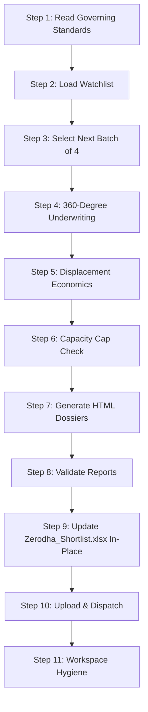

# Indian Watchlist to Stocklist Workflow Executor

This workflow is the **Indian Watchlist→Shortlist Underwriting Engine**. It runs the `watchlist_shortlist_underwriting` skill for the next batch of 4 NSE/BSE stocks, performs 360-degree underwriting with displacement economics, generates HTML dossiers, and updates `Zerodha_Shortlist.xlsx` in-place.

This workflow is designed to run **manually** (on-demand) when the user wants to promote stocks from the watchlist to the shortlist.

---

## 0. Governing Standards & Non-Negotiable Rules

Before executing any step, you MUST read and internalize the following governing documents. These are the **single source of truth** for all underwriting logic, data rules, and report formatting.

### 0.1 Required Skill & Standard Files

| File | Purpose |
|---|---|
| [Watchlist Shortlist Underwriting Skill](../skills/watchlist_shortlist_underwriting/SKILL.md) | 360-degree underwriting framework, displacement economics, capacity caps, dossier format |
| [Report Editorial Standard](../skills/_shared/REPORT_EDITORIAL_STANDARD.md) | HTML report structure, typography, color palette, callout boxes, validation rules |
| [Run Protocol](../skills/_shared/RUN_PROTOCOL.md) | Run isolation, freshness, cleanup, publication |
| [Report Voice](../skills/_shared/REPORT_VOICE.md) | Plain-English explanation of every heading; no template phrases |

### 0.2 Core Non-Negotiables

1. **Batch Size = 4**: Process exactly 4 stocks per run. Do NOT process more or fewer.
2. **360-Degree Underwriting**: Every stock must be underwritten across all dimensions: fundamentals, technicals, valuation, catalysts, risks, sector positioning.
3. **Displacement Economics**: Calculate the opportunity cost of adding this stock to the shortlist. What does it displace?
4. **Capacity Caps**: Respect the shortlist capacity caps:
   - **10 Core Alpha** positions
   - **10 Tactical Momentum** positions
5. **Live Web Search**: Use DuckDuckGo web search extensively. This is very important to the user.
6. **HTML Dossiers**: Each stock gets a full HTML dossier at `googledrive/blogs/<SYMBOL>_dossier.html`.
7. **In-Place Update**: `Zerodha_Shortlist.xlsx` must be updated in-place. Do NOT create a new file.
8. **Rupee Arithmetic**: All financial figures in INR. Use Indian number formatting (lakh/crore) where appropriate.
9. **NSE/BSE Only**: Only process stocks listed on NSE or BSE.

---

## 1. Execution Pipeline (Step-by-Step)



---

### Step 1: Read Governing Standards

1. Read the full `watchlist_shortlist_underwriting` skill file.
2. Read the `REPORT_EDITORIAL_STANDARD.md`.
3. Confirm you understand the 360-degree underwriting framework, displacement economics, and capacity caps.

> [!NOTE]
> Do NOT proceed to Step 2 until you have fully internalized the skill's underwriting logic.

---

### Step 2: Load Watchlist

1. Read `watchlist/Zerodha_Watchlist.xlsx`.
2. Parse all watchlist stocks: symbol, sector, current price, watchlist date, thesis.
3. Identify stocks already in the shortlist — exclude these.
4. Identify stocks that have been rejected — exclude these.

```bash
# Verify the watchlist file exists and is readable
ls -la watchlist/Zerodha_Watchlist.xlsx
```

---

### Step 3: Select Next Batch of 4

1. From the remaining watchlist stocks (not yet in shortlist, not rejected), select the **next 4** in priority order.
2. Priority order is determined by:
   - Time on watchlist (longest waiting first)
   - Recent catalysts or news
   - Sector diversification
   - Conviction score from prior reviews
3. Log the selected batch with symbols and current theses.

---

### Step 4: 360-Degree Underwriting

For **each of the 4 stocks**, perform full 360-degree underwriting:

1. **Fundamentals**: Revenue growth, margins, FCF, ROE, debt, promoter holding.
2. **Technicals**: Price trend, key levels, volume, RSI, MACD.
3. **Valuation**: P/E, P/B, EV/EBITDA vs. sector and historical.
4. **Catalysts**: Upcoming events, product launches, policy changes.
5. **Risks**: Competitive threats, regulatory, management, concentration.
6. **Sector Positioning**: Where does this stock sit in its sector? Leader, challenger, or laggard?

> [!CAUTION]
> Use DuckDuckGo web search extensively for each stock. Verify current data. Do NOT rely on cached or stale information. This is very important to the user.

---

### Step 5: Displacement Economics

For each stock, calculate the displacement economics:

1. **What does this stock displace?** If the shortlist is at capacity, which existing stock would be removed?
2. **Opportunity Cost**: Compare the expected return of the new stock vs. the displaced stock.
3. **Net Alpha**: Is the new stock a net positive for the portfolio?

Document the displacement analysis with specific numbers.

---

### Step 6: Capacity Cap Check

1. Check current shortlist composition:
   - Core Alpha: X/10
   - Tactical Momentum: Y/10
2. Determine which category each new stock fits into.
3. If the category is at capacity, identify the weakest existing stock to displace.
4. If both categories are at capacity, only add stocks that clearly outperform the weakest existing holdings.

---

### Step 7: Generate HTML Dossiers

For **each of the 4 stocks**, generate a full HTML dossier:

1. **Header**: Symbol, sector, current price, date, "Watchlist → Shortlist Dossier"
2. **Executive Summary**: 3–5 sentence thesis
3. **Fundamental Analysis**: Revenue, margins, FCF, ROE, debt
4. **Technical Analysis**: Trend, key levels, volume
5. **Valuation**: P/E, P/B, EV/EBITDA vs. sector
6. **Catalysts & Risks**: Upcoming events, key risks
7. **Displacement Economics**: What it displaces, opportunity cost
8. **Verdict**: SHORTLIST (Core Alpha / Tactical Momentum) or REMAIN WATCHLIST

Write each dossier to `googledrive/blogs/<SYMBOL>_dossier.html`.

```bash
# Verify all dossiers were created
ls -la googledrive/blogs/*_dossier.html
```

---

### Step 8: Validate Reports

```bash
python3 scripts/validate_report.py --kind dossier
```

- If `RESULT: PASS` → proceed to Step 9.
- If `RESULT: FAIL` → fix and re-validate.

---

### Step 9: Update Zerodha_Shortlist.xlsx In-Place

1. For each stock classified as **SHORTLIST**:
   - Add to `Zerodha_Shortlist.xlsx` with: symbol, sector, category (Core Alpha / Tactical Momentum), entry price, thesis, date.
   - If displacing an existing stock, remove the displaced stock.
2. For each stock classified as **REMAIN WATCHLIST**:
   - Update the watchlist with the re-evaluation date and rationale.
3. Do NOT create a new file. Modify the existing workbook.

---

### Step 10: Upload & Dispatch

1. Upload all dossiers to Google Drive.
2. Send email with summary:
   - X stocks promoted to shortlist
   - Y stocks remain on watchlist
   - Links to all dossiers

```bash
python3 scripts/send_email.py --report "googledrive/blogs/" --subject "Indian Watchlist to Shortlist - $(date +%Y-%m-%d)"
```

---

### Step 11: Workspace Hygiene & Cache Pruning

1. Delete any transient scripts or temp files created during execution (`rm -f scripts/build_*.py scripts/generate_*.py` and `rm -rf scripts/__pycache__/`).
2. Run Directory Cleanup: once the validation gate passes and artifacts are saved, delete this run's directory with `rm -rf "<RUN_DIR>"` (RUN_PROTOCOL §5). On failure, keep it and report its path.
3. Preserve the permanent infrastructure whitelist:
   - `scripts/market_facts.py`
   - `scripts/validate_report.py`
   - `scripts/send_email.py`
   - `scripts/build_dossier_portal.py`
   - `scripts/serve_blogs.py`
   - `scripts/dossier_builder_template.py`
   - `scripts/com.portfolio.blogs.fileserver.plist`
   - `scripts/config/aliases.json`
   - `watchlist/Zerodha_Watchlist.xlsx`
   - `Zerodha_Shortlist.xlsx`
   - `googledrive/` directory structure

> [!NOTE]
> The workflow is complete when the shortlist is updated, all dossiers are dispatched, and the workspace is clean.
