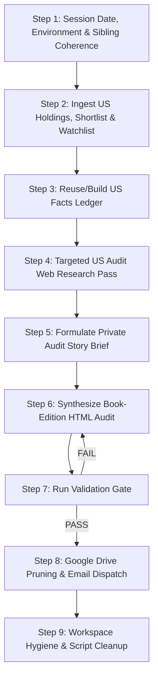

# US Equity Portfolio Forensic Audit & Capital Reallocation Workflow Executor

This workflow governs the deterministic, end-to-end execution of the **US Portfolio Forensic Audit & Capital Reallocation Engine**. It reconciles active brokerage holdings from `sheets/US_Portfolio_Holdings.xlsx` against vetted opportunities from `shortlist/US_Shortlist.xlsx`, executes unconstrained greenfield capital allocation across Core Alpha, Tactical Momentum, and Leveraged Satellite books, enforces zero-holding-bias displacement forensics, verifies mathematical reconciliation down to the single dollar ($), and dispatches the briefing via Gmail.

---

## 0. Governing Standards & Non-Negotiable Rules

Before commencing execution, review and adhere strictly to:
- [us_portfolio_audit/SKILL.md](../skills/us_portfolio_audit/SKILL.md)
- [_shared/REPORT_EDITORIAL_STANDARD.md](../skills/_shared/REPORT_EDITORIAL_STANDARD.md) (Binding specification: Pipeline order, Blueprint 7B, Book Edition narrative standard, and Coherence Protocol)
- [_shared/RUN_PROTOCOL.md](../skills/_shared/RUN_PROTOCOL.md) (Binding: run isolation, freshness, cleanup, publication)
- [_shared/REPORT_VOICE.md](../skills/_shared/REPORT_VOICE.md) (Binding: how every heading is explained; banned template phrases)

### Core Non-Negotiables:
1. **Cross-Report Coherence & Single Facts Ledger:**
   - This run builds its own ledger with `--run-dir`. Market regime, sector map, prices, DMAs, and Weinstein stages come only from that ledger. The same-day Market Intelligence report is a published sibling, used for reconciliation (next item), never as a substitute.
   - If `docs/reports/US_Market_Intelligence_<YYYY-MM-DD>.html` exists, read it first and reconcile: verbatim identical `regime.label`, identical prices and stages for every shared ticker.
   - **Mandatory Bear List Action:** Any held security appearing on today's US Market Intelligence Bear List (Section 4) MUST receive an explicit defensive audit verdict in Chapter 2 (`EXIT`, `TRIM`, or ratcheted `HARD STOP`); it can never be passively ignored as `KEEP`.
   - **Pipeline Feedback Loop:** Watchlist ingestion must not include any ticker that this audit designates for `EXIT`.
2. **Adversarial Decoupled Multi-Agent Architecture:**
   - **Holding Defense Auditor:** Audits existing holdings ruthlessly against technical breakdowns, SBC dilution acceleration, dead money, and earnings risks.
   - **Greenfield Allocator (Zero Holding Bias):** Allocates the total portfolio net worth as 100% fresh cash across the vetted shortlist without any knowledge of incumbent holdings, cost bases, or unrealized P&L.
   - **Master CIO Reconciler:** Reconciles the two views using the deterministic 3-Condition Swap Framework.
3. **Book Edition for a Beginner Holding This Portfolio (Blueprint 7B):**
   - `<div class="primer">`: **450+ words** opening primer explaining the audit method, the three independent analysts, stop formulas, the 20% concentration rule and its momentum exception, mechanics of daily-reset leveraged ETFs (volatility decay) and LEAPS, the 3-condition swap test, and asymmetry hurdles.
   - **Lede:** **250–400 words** executive summary stating the portfolio's condition, net worth, total money at risk, and the primary capital rebalancing directive.
   - **Section Essays:** Every H2 opens with a 200+ word essay and closes with a 100+ word "What this means for you" paragraph plus a `<p class="chapter-bridge">`. Total prose per H2 must exceed 500 words. Total report prose must exceed 9,000 words (target: 12,000–20,000 words).
   - `<div class="howto">`: 50+ words before every data table (explaining columns and reading one real row aloud).
   - `<p class="takeaway">`: 120+ words after every data table (naming specific tickers, numbers, and key levels).
   - **Holding Case Notes (MANDATORY & ENFORCED):** `<div class="casenote" data-symbol="TICKER">`: **ONE case note for EVERY active holding in `US_Portfolio_Holdings.xlsx` without exception** (including common equities, leveraged ETFs, and LEAPS options), plus every greenfield buy and notable 0% exclusion. Each note must be 80+ words (target 130–200 words), containing numbers and explicit triggers (`if|unless|until|would|trigger|below|above|breaks?|closes?`) following the fixed 5-point structure:
     (a) What the company/instrument is;
     (b) Why you own it / why it is in the book;
     (c) The numbers and what they mean (CMP, DMAs, Stage, RSI, Vol Mult, Distance to support in ATRs, P&L);
     (d) The verdict and the exact deterministic rule that triggered it;
     (e) What would change the verdict, with explicit price levels.
   - `<div class="example">`: At least 1 worked numeric example walking real dollar arithmetic end-to-end (e.g. concentration trimming arithmetic, position sizing, or leverage volatility drag).
   - `<div class="triggers">`: **At least 8 trigger blocks** ("What would change this view" with explicit if/then levels).
   - **Glossary & Methodology:** Explicit `<h2 id="glossary">Glossary</h2>` and a methodology & data-gaps note.
4. **Mathematical Precision & Cash Waterfall Reconciliation:**
   - Every percentage must sum to 100.0% ($\sum \text{Allocated Wt} + \text{Cash Buffer} = 100.0\%$).
   - Chapter 5 cash waterfall (Starting Cash + Sells - Buys = Ending Cash) must reconcile to the single dollar ($) with Chapters 2 and 3.
5. **Deterministic Pre-Send Gate:** `python3 scripts/validate_report.py --kind portfolio_audit` MUST output `RESULT: PASS` before any Google Drive pruning or email transmission.

---

## 1.5 Independent Reviewer Gate (mandatory before delivery)

Every report from this workflow must pass the `report_reviewer` skill (`../skills/report_reviewer/SKILL.md`) before it is saved to docs/, published, or emailed.

1. **Run the reviewer passes.** Read `../config/reviewer.json` and `../skills/_shared/REVIEWER_OPERATIONS.md`. Run each pass in the config as a separate fresh agent, using the model set in the config. Do not name a model in this workflow.
2. **Give the reviewer only its inputs:** the report path, `<RUN_DIR>/cache/facts_<MKT>_<date>.json`, `<RUN_DIR>/cache/research_<MKT>_<date>.json`, the snapshots in `<RUN_DIR>/inputs/`, the sibling report if it exists, the three standards in `../skills/_shared/`, and the validator output. Do not pass the Story Brief, your drafts, or your reasoning.
3. **Act on the result.** The reviewer writes `<RUN_DIR>/review_round_<N>.json`. On `REVISE` or `BLOCK`, fix every BLOCK and REVISE finding in the report, re-run `validate_report.py` until it shows `RESULT: PASS`, and send the report back to the reviewer. Address NOTE findings where practical.
4. **Round limit.** Run at most two review rounds. If the report is still not `APPROVE` after round two, do not deliver. Keep `<RUN_DIR>`, and report the open findings to the user.
5. **Delivery condition.** Save to docs/, publish, or send email only when the reviewer returns `APPROVE` and the validator returns `RESULT: PASS`. Record both results in `<RUN_DIR>/manifest.json`.

## 1. Execution Pipeline (Step-by-Step)



---

### Step 1: Session Date, Environment, Run Directory & Sibling Coherence

1. **Determine Session Date (`<YYYY-MM-DD>`):**
   - Check the active US market trading session date (Eastern Time / ET). If running after 16:30 ET on a weekday, use today's date. If on a weekend or holiday, use the most recent completed US trading session date.
2. **Fresh Run Directory (see `../skills/_shared/RUN_PROTOCOL.md` §1):**
   - Create this run's private directory. Nothing from earlier runs is read; ledgers, research, and prior report HTML are never inputs.
     ```bash
     RUN_DIR="$(mktemp -d "${TMPDIR:-/tmp}/portfolio-<MKT>-<YYYY-MM-DD>-XXXX")" && mkdir -p "$RUN_DIR/cache" "$RUN_DIR/inputs" "$RUN_DIR/work"
     ```
3. **Ingest Sibling US Market Intelligence Report:**
   - Read `docs/reports/US_Market_Intelligence_<YYYY-MM-DD>.html` for the session date, if it exists. Reconcile it against this run's ledger; never use it in place of the ledger.
   - Record the verbatim `regime.label`, market breadth, US 11-group sector quadrant map, and the 30 names on the Bear List.
   - If a market report exists for today, the audit's Chapter 1 must restate its regime and sector matrix verbatim.
4. **Verify Environment & SMTP Credentials:**
   - Confirm `.env` exists with `GMAIL_USER`, `GMAIL_APP_PASSWORD`, and `GMAIL_RECIPIENT` (default: `rajasekharreddymekala732@gmail.com`).
   - Confirm target paths are accessible:
     - `sheets/US_Portfolio_Holdings.xlsx` (or `sheets/US_Portfolio_Holdings.xlsx`)
     - `shortlist/US_Shortlist.xlsx` (or `shortlist/US_Shortlist.xlsx`)
     - `watchlist/US_Portfolio_Watchlist.xlsx` (or `watchlist/US_Portfolio_Watchlist.xlsx`)
     - `docs/reports/`

---

### Step 2: Ingest US Holdings, Shortlist & Watchlist Workbooks

1. **Active Holdings (`sheets/US_Portfolio_Holdings.xlsx`):**
   - Read the `Holdings` sheet. Extract for every position:
     - `Symbol`: US ticker
     - `Quantity`: Number of shares held (or contracts for options)
     - `Average Price`: Cost basis ($)
     - `Current Price`: Workbook closing price ($)
     - `Current Value`: Workbook market value ($)
     - `P&L` and `P&L %`: Unrealized profit/loss
   - Extract Total Account Net Worth ($), Total Equities Market Value, and Cash Margin Buffer.
2. **Vetted Shortlist (`shortlist/US_Shortlist.xlsx`):**
   - Read `Master_Shortlist`. Ingest curated candidates across Core Alpha, Tactical Momentum, and Leveraged Satellite books.
   - Note key operational metrics: ROIC, 3Y Sales CAGR, Debt/EBITDA, Support Proximity, and Asymmetry Ratios.
3. **Watchlist (`watchlist/US_Portfolio_Watchlist.xlsx`):**
   - Read `Active_Watchlist` to audit candidate pipelines and verify that no ticker marked for exit in this audit is scheduled for ingestion.
4. **Price Valuation Rule:**
   - Value all positions at the **ledger close**. If the workbook price differs slightly from the ledger close due to snapshot timing, note the discrepancy once in the Methodology section; all portfolio math, weights, and P&L must align with the ledger.

---

### Step 3: Build Fresh US Facts Ledger from Scratch (Zero Prior Bias)

1. **Generate Fresh Facts Ledger:**
   - Always generate a fresh facts ledger for the designated session date `<YYYY-MM-DD>` from live market data:
     ```bash
     python3 scripts/market_facts.py --market US --date <YYYY-MM-DD> --screen sp1500 --run-dir "<RUN_DIR>"
     ```
   - Running from scratch guarantees zero prior-session bias and ensures all market breadth, moving averages, and prices reflect live, unpolluted market data.
2. **Triage Holdings & Shortlist Failures:**
   - Verify that every ticker in `US_Portfolio_Holdings.xlsx` and `US_Shortlist.xlsx` has valid entries in `facts["instruments"]`.
   - If any holding or shortlist symbol is listed in `facts["failures"]`, resolve it via `scripts/config/aliases.json` (e.g., `BRK.B` vs `BRK-B`) and re-run with `--extra <SYMBOL>` before proceeding.

---

### Step 4: Audit-Specific Targeted Web Research Pass (duck-duck-go MCP)

Extend `<RUN_DIR>/cache/research_US_<YYYY-MM-DD>.json` using the `duck-duck-go` MCP tools (`search` + `fetch_content`) for portfolio-specific items:

1. **Per-Symbol Research Requirements:**
   - `earnings_calendar`: Next earnings announcement dates for every holding and top greenfield buy over the next 14 days (for pre-earnings risk mitigation).
   - `form4_cluster_buys`: SEC Form 4 insider open-market purchases and cluster buying disclosures for holdings.
   - `filing_gates`: ROIC, 3Y CFO/NI, net debt/EBITDA from SEC companyfacts / Finviz for greenfield candidates.
   - `catalyst_news`: Fundamental catalysts, product launches, FDA approvals, contract announcements, or management guidance behind every recommended `EXIT` / `TRIM` and every top greenfield `BUY`.
2. **Protocol Compliance:**
   - Target queries with the session date (e.g., `{symbol} next earnings date October 2026`).
   - Fetch the actual page content via `fetch_content` to confirm dates and figures.
   - Append findings to `<RUN_DIR>/cache/research_US_<YYYY-MM-DD>.json` with `key`, `symbol`, `status: "found"`, `value`, `source_url`, and `as_of`. If not found, log $\ge 3$ distinct queries tried.

---

### Step 5: Formulate the Private Audit Story Brief

Draft a private 8-bullet analytical brief to govern cross-chapter coherence:
1. **Portfolio Health & Net Worth:** Total Net Worth ($), Equities Value ($), Cash Buffer ($, %), Total Unrealized P&L ($, %).
2. **Macro & Sector Alignment:** Over/under-allocation to leading vs lagging US sectors, regime-mandated cash target.
3. **Concentration & Super-Performer Diagnostics:** Top-3 holding concentration vs 20% limit, evaluation of the Super-Performer Momentum Exception for winners.
4. **Active Holdings Extraction Verdicts:** Classification of each holding into `EXIT`, `TRIM`, `HOLD / HARD STOP`, or `HOLD / TRAIL`, and total capital liberated ($ and %).
5. **Bear List Conflict Resolution:** Explicit defensive verdicts for any holding appearing on today's US Market Intelligence Bear List.
6. **Greenfield Target Portfolio:** Optimal unconstrained shortlist allocation across Core Alpha (35–45%), Tactical Momentum (40–55%), Leveraged Satellite (5–15%), and Cash (5–10%).
7. **Displacement Decisions:** Specific 3-condition swap test outcomes (which challenger displaces which holding).
8. **Cash Waterfall & Execution Sequence:** Exact dollar reconciliation from Phase 1 sells/trims to Phase 2 limit buys, ending cash balance, and trailing stop order schedule.

---

### Step 6: Synthesize the Book-Edition HTML Report

Generate the standalone HTML briefing at:
`docs/reports/US_Portfolio_Audit_<YYYY-MM-DD>.html`

#### Visual Design & Scaffolding:
- **Typography:** Embed Google Fonts (`Inter`, `Newsreader`, `JetBrains Mono`).
- **Styles:** Embed standard Wikipedia CSS rules + append `.agents/skills/_shared/book_components.css` inside `<style>`.
- **Navigation Links:** Every ticker in every table must include clickable TradingView and Finviz links:
  `<b>{SYMBOL}</b><br><span style="font-size: 11px;"><a href="https://www.tradingview.com/chart/?symbol={EXCHANGE}%3A{SYMBOL}" target="_blank" style="color: #1d4ed8;">Chart</a> • <a href="https://finviz.com/quote.ashx?t={SYMBOL}" target="_blank" style="color: #006600;">Finviz</a></span>`

#### 7-Chapter Structure & Content Requirements:

| Chapter | Required Components & Prose Depth |
|---|---|
| **Header & Executive Infobox** | Floated `table.infobox` capturing: Total Account Net Worth ($), Equities Market Value, Cash Margin Buffer, Invested Capital, Total Unrealized P&L, 4-Pillar Allocation Split (Core %, Tactical %, Leveraged %, Cash %), and **Total Money at Risk** (sum of shares $\times$ (price - stop) in $ and % of net worth). |
| **Primer ("Start here")** | `<div class="primer">`: **450+ words**. Explaining the audit method, the three independent analysts, why the greenfield picker ignores incumbent holdings, stop-loss formulas, 20% concentration ceiling & momentum exception, mechanics of daily-reset leveraged ETFs & LEAPS, 3-condition swap test, and asymmetry hurdles. |
| **Lede** | **250–400 words**. Executive summary stating the portfolio's condition, net worth, total money at risk, and the primary rebalancing directive. |
| **1. Macro Alignment & Sector Exposure** | **500+ words prose**. Verbatim restatement of ledger `regime.label` and US 11-group sector rotation quadrants. Analysis of how much portfolio capital sits in Leading vs Lagging sectors. Implications for cash levels. Triggers block. Chapter bridge. |
| **2. Active Holdings Forensic Extraction Ladder** | **500+ words prose**. Essay on concentration risks with real portfolio numbers. Worked example of concentration trimming arithmetic (`<div class="example">`). Holdings Extraction Ladder table (Rank 1 to N) with howto + takeaway. **ONE case note (`<div class="casenote" data-symbol="...">`) for EVERY holding in `US_Portfolio_Holdings.xlsx` without exception** (including leveraged ETFs and LEAPS) following fixed a–e structure. **Money-at-Risk Table** (shares, CMP, stop, currency at risk, % of net worth) with takeaway. Triggers block per strategy bucket. Chapter bridge. |
| **3. Greenfield Unconstrained Shortlist Allocation** | **500+ words prose**. The thought experiment: *"If given 100% cash today, what would we buy?"* Target portfolio table (howto + takeaway). **Case note for every greenfield buy** (thesis, entry zone, stop logic, target logic, sizing). **0% Exclusion Table** listing passed shortlist candidates with specific reasons and the trigger level that would make each a buy. Strategy bucket reconciliation vs mandate. Triggers block. Chapter bridge. |
| **4. Shortlist Strategy Funnel & Displacement Forensics** | **500+ words prose**. Detailed walkthrough of the 3-Layer Gating Hurdles (Financial, Operational KPIs, Support-Aware Entry) with real passing and failing examples. The **3-Condition Swap Test** written with exact numbers for every displacement or non-displacement. Tax and slippage considerations. Triggers block. Chapter bridge. |
| **5. Master Capital Reallocation (Money Bridge) & Waterfall** | **500+ words prose**. Step-by-step **Cash Waterfall Table** (Starting cash, + each sale/trim, - each buy, ending cash, running balance). Explanatory prose for every line. Scenario analysis: if every new stop hits, if market falls 10%, if limit orders do not fill. Dollar reconciliation to Chapters 2 and 3. Triggers block. Chapter bridge. |
| **6. 3-Phase Actionable Execution Orders** | **500+ words prose**. Three distinct wikitables: Phase 1 (Sells & Trims), Phase 2 (Limit Buys at Support), Phase 3 (Defensive Trailing Stops). Plain-English execution instructions with trigger, limit, expiry, and broker placement steps (Charles Schwab / Robinhood). Execution checklist. Triggers block for the whole plan. Chapter bridge. |
| **7. Rulebook & Monitoring Protocol** | **500+ words prose**. Summary of active quantitative decision rules with current figures. Levels and dates to monitor. Primary portfolio risks and unknowns. Recommended audit re-run frequency. |
| **End Matter** | `<h2 id="glossary">Glossary</h2>` defining financial and risk metrics, Methodology & Data Gaps note, and `<ol class="reflist">` References with numbered citations (SEC EDGAR, CBOE, Finviz). |

---

### Step 7: Pre-Send Deterministic Validation Gate

Execute `scripts/validate_report.py` against the generated HTML audit and facts ledger:

```bash
python3 scripts/validate_report.py \
  --report "docs/reports/US_Portfolio_Audit_<YYYY-MM-DD>.html" \
  --kind portfolio_audit \
  --facts "<RUN_DIR>/cache/facts_US_<YYYY-MM-DD>.json"
```

#### Strict Pass Criteria for US Portfolio Audit:
- **Total Prose:** $\ge 9,000$ words (target: 12,000–20,000 words)
- **Per H2 Section Prose:** $\ge 500$ words each
- **Primer:** $\ge 450$ words
- **How-to-Read Blocks:** $\ge 6$ blocks
- **Table Intros / Takeaways:** Intros $\ge 50$ words, takeaways $\ge 120$ words
- **Trigger Blocks:** $\ge 8$ blocks with explicit if/then levels
- **Worked Examples:** $\ge 1$ block walking dollar math end-to-end
- **Holdings Case Note Completeness (STRICT):** **EVERY holding in `US_Portfolio_Holdings.xlsx` MUST have a case note** (`<div class="casenote" data-symbol="TICKER">`) with $\ge 80$ words, containing numbers and triggers. The validator will fail if even one holding is missing!
- **N/A Budget:** $\le 5.0\%$ overall, $\le 25\%$ in any table
- **Price & Stage Fidelity:** CMPs match ledger closes within 1.5%; stages match ledger exactly
- **Research Coverage:** `<RUN_DIR>/cache/research_US_<YYYY-MM-DD>.json` covers all audit research needs

> [!CAUTION]
> If the validator outputs `FAIL`, you MUST inspect the errors, fix the HTML report in-place, and re-run the validator until it outputs `RESULT: PASS`. Never bypass the gate or lower thresholds.

---

### Step 8: Google Drive Maintenance & Email Transmission

Only after `validate_report.py` outputs `RESULT: PASS`:

1. **Google Drive Single-Latest Version Lifecycle:**
   - Scan `docs/reports/` for older versions matching `US_Portfolio_Audit_*.html` (excluding the newly validated session file).
   - Delete/prune all prior versions so Google Drive maintains strictly only the single latest audit report showing the current run date.
2. **Automated Email Dispatch:**
   - Dispatch the audit report to `rajasekharreddymekala732@gmail.com` via `scripts/send_email.py`:

```bash
python3 scripts/send_email.py \
  --subject "🏛️ Master US Portfolio Forensic Audit & Capital Reallocation Blueprint | <YYYY-MM-DD> — Net Worth: $<Amount>" \
  --html-file "docs/reports/US_Portfolio_Audit_<YYYY-MM-DD>.html" \
  --recipient "rajasekharreddymekala732@gmail.com"
```

- Verify that SMTP transmission finishes with exit code `0`.

---

### Step 9: Workspace Hygiene, Script Cleanup & Cache Pruning

1. **Delete Transient Scripts:**
   - Remove any temporary generator, audit builder, or calculator scripts created during this run:
     ```bash
     rm -f scripts/build_*.py scripts/generate_*.py scripts/audit_*.py scripts/update_*.py scripts/make_*.py scripts/fix_*.py scripts/apply_*.py
     rm -rf scripts/__pycache__/ __pycache__/
     ```
2. **Run Directory Cleanup**
   - After email dispatch completes, delete `<RUN_DIR>` (RUN_PROTOCOL §5):
     ```bash
     ```
3. **Preserve Permanent Infrastructure Whitelist:**
   - `scripts/market_facts.py`
   - `scripts/validate_report.py`
   - `scripts/send_email.py`
   - `scripts/build_dossier_portal.py`
   - `scripts/serve_blogs.py`
   - `scripts/dossier_builder_template.py`
   - `scripts/com.portfolio.blogs.fileserver.plist`
   - `scripts/config/aliases.json`
   - `.agents/`
4. **Verify Clean Tree:** Run `ls scripts/` and confirm only whitelisted files remain.
