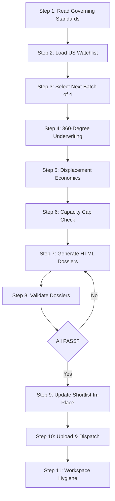

# US Watchlist to Shortlist Workflow Executor

This workflow is the **US Watchlist → Shortlist Underwriting Engine**. It processes the next batch of 4 US watchlist candidates through a rigorous 360-degree underwriting process, generates detailed HTML dossiers for each candidate, and updates the shortlist with displacement economics and capacity cap enforcement.

This workflow is designed to run **manually** (on-demand) when the user wants to advance the next batch of US watchlist candidates to the shortlist.

---

## 0. Governing Standards & Non-Negotiable Rules

Before executing any step, you MUST read and internalize the following governing documents. These are the **single source of truth** for all underwriting logic, data rules, and report formatting.

### 0.1 Required Skill & Standard Files

| File | Purpose |
|---|---|
| [US Watchlist Shortlist Underwriting Skill](file:///Users/mereddy/Desktop/github/portfolio/.agents/skills/us_watchlist_shortlist_underwriting/SKILL.md) | 360-degree underwriting framework, displacement economics, capacity caps, dossier format, batch processing rules |
| [Report Editorial Standard](file:///Users/mereddy/Desktop/github/portfolio/.agents/skills/_shared/REPORT_EDITORIAL_STANDARD.md) | HTML report structure, typography, color palette, callout boxes, validation rules |

### 0.2 Core Non-Negotiables

1. **Batch Size = 4**: Process exactly 4 candidates per run. Do NOT process more or fewer.
2. **360-Degree Underwriting**: Every candidate must be evaluated across all dimensions: business model, financials, valuation, technicals, catalysts, risks, and competitive moat.
3. **Displacement Economics**: For each candidate, calculate the displacement economics — what position would it replace in the shortlist, and what is the opportunity cost?
4. **Capacity Caps**: Enforce the shortlist capacity caps:
   - **10 Core Alpha** positions
   - **10 Tactical Momentum** positions
   - **5 Leveraged Satellite** positions
5. **HTML Dossiers**: Each candidate must produce a detailed HTML dossier at `googledrive/blogs/<SYMBOL>_dossier.html`.
6. **Live Web Search**: Use DuckDuckGo web search extensively to verify current fundamentals, technicals, and catalysts. Do NOT rely on stale data.
7. **Validation Gate**: Each dossier must pass `python3 scripts/validate_report.py --kind dossier` before dispatch.
8. **In-Place Update**: The shortlist workbook must be updated in-place. Do NOT create a new file.

---

## 1. Execution Pipeline (Step-by-Step)



---

### Step 1: Read Governing Standards

1. Read the full `us_watchlist_shortlist_underwriting` skill file.
2. Read the `REPORT_EDITORIAL_STANDARD.md`.
3. Confirm you understand the 360-degree underwriting framework, displacement economics, capacity caps, and dossier format.

> [!NOTE]
> Do NOT proceed to Step 2 until you have fully internalized the skill's underwriting logic.

---

### Step 2: Load US Watchlist

1. Read `US_Portfolio_Watchlist.xlsx` from the portfolio root.
2. Parse all watchlist candidates: symbol, sector, current price, key metrics, status.
3. Identify candidates that are already in the shortlist — exclude these.

```bash
# Verify the file exists and is readable
ls -la US_Portfolio_Watchlist.xlsx
```

---

### Step 3: Select Next Batch of 4

1. From the remaining watchlist candidates (not yet in shortlist), select the **next 4** in priority order.
2. Priority order is determined by:
   - Time on watchlist (longest waiting first)
   - Recent catalysts or news
   - Sector diversification (avoid clustering in one sector)
3. Log the selected batch with symbols and rationale.

---

### Step 4: 360-Degree Underwriting

For **each of the 4 candidates**, perform a full 360-degree underwriting:

1. **Business Model**: What does the company do? Revenue model, customer base, competitive moat.
2. **Financials**: Revenue growth, margins, FCF, debt, ROIC, SBC dilution.
3. **Valuation**: P/E, EV/EBITDA, P/S, P/FCF vs. historical and peers.
4. **Technicals**: Trend, support/resistance, volume, RSI, moving averages.
5. **Catalysts**: Upcoming events (earnings, product launches, regulatory decisions).
6. **Risks**: Key risks that could invalidate the thesis.
7. **Competitive Moat**: Network effects, switching costs, brand, cost advantage, IP.

> [!CAUTION]
> Use live web search (DuckDuckGo) extensively for each candidate. Verify current financials, recent news, and analyst consensus. Do NOT rely on cached or stale data.

---

### Step 5: Displacement Economics

For each candidate that passes underwriting:

1. **Identify the displacement**: Which existing shortlist position would this candidate replace?
2. **Calculate opportunity cost**: What is the expected return of the displaced position vs. the new candidate?
3. **Net alpha contribution**: Does the new candidate add net alpha to the portfolio?
4. **Sector impact**: Does adding this candidate improve or worsen sector diversification?

---

### Step 6: Capacity Cap Check

1. Check current shortlist composition against capacity caps:
   - Core Alpha: X/10
   - Tactical Momentum: Y/10
   - Leveraged Satellite: Z/5
2. If the candidate's category is at capacity, it must displace an existing position.
3. If no displacement is justified, the candidate remains on the watchlist.

---

### Step 7: Generate HTML Dossiers

For **each of the 4 candidates**, generate a detailed HTML dossier:

1. **Header**: Symbol, company name, date, "US Watchlist → Shortlist Dossier"
2. **Executive Summary**: 3–5 sentence thesis
3. **Business Model & Moat**: Detailed analysis
4. **Financial Deep Dive**: Key metrics, trends, peer comparison
5. **Valuation**: Multiple valuation frameworks
6. **Technical Analysis**: Chart description, key levels
7. **Catalysts & Timeline**: Upcoming events with dates
8. **Risk Assessment**: Key risks with probability/impact
9. **Displacement Economics**: What it replaces, opportunity cost
10. **Verdict**: SHORTLIST (with category) or REMAIN ON WATCHLIST

Write each dossier to `googledrive/blogs/<SYMBOL>_dossier.html`.

```bash
# Verify all 4 dossiers were created
ls -la googledrive/blogs/*_dossier.html
```

---

### Step 8: Validate Dossiers

```bash
# Validate each dossier
for symbol in <SYMBOL_1> <SYMBOL_2> <SYMBOL_3> <SYMBOL_4>; do
    python3 scripts/validate_report.py --kind dossier --file "googledrive/blogs/${symbol}_dossier.html"
done
```

- If all `RESULT: PASS` → proceed to Step 9.
- If any `RESULT: FAIL` → fix the issues and re-validate.

---

### Step 9: Update Shortlist In-Place

1. Update `US_Portfolio_Shortlist.xlsx` (or the relevant shortlist workbook) in-place:
   - Add new candidates with their category (Core Alpha / Tactical Momentum / Leveraged Satellite)
   - Remove displaced candidates
   - Update timestamps and notes
2. Do NOT create a new file. Modify the existing workbook.

---

### Step 10: Upload & Dispatch

1. Upload all 4 HTML dossiers to Google Drive (single-latest versioning).
2. Send a summary email via `scripts/send_email.py` with links to all 4 dossiers.

```bash
python3 scripts/send_email.py --subject "US Watchlist → Shortlist: Batch of 4 - $(date +%Y-%m-%d)" --body "Dossiers: <SYMBOL_1>, <SYMBOL_2>, <SYMBOL_3>, <SYMBOL_4>"
```

---

### Step 11: Workspace Hygiene & Cache Pruning

1. Delete any transient scripts or temp files created during execution (`rm -f scripts/build_*.py scripts/generate_*.py` and `rm -rf scripts/__pycache__/`).
2. Mandatory Cache Cleanup: Prune any stale prior-session cache files from `scripts/.cache/` (e.g. `find scripts/.cache/ -type f ! -name "aliases.json" -delete` for older session files) to ensure zero cross-session state pollution.
3. Preserve the permanent infrastructure whitelist:
   - `scripts/market_facts.py`
   - `scripts/validate_report.py`
   - `scripts/send_email.py`
   - `scripts/build_dossier_portal.py`
   - `scripts/serve_blogs.py`
   - `scripts/dossier_builder_template.py`
   - `scripts/com.portfolio.blogs.fileserver.plist`
   - `scripts/.cache/aliases.json`
   - `US_Portfolio_Watchlist.xlsx`
   - `US_Portfolio_Shortlist.xlsx`
   - `googledrive/` directory structure

> [!NOTE]
> The workflow is complete when all 4 dossiers are dispatched and the shortlist is updated.
