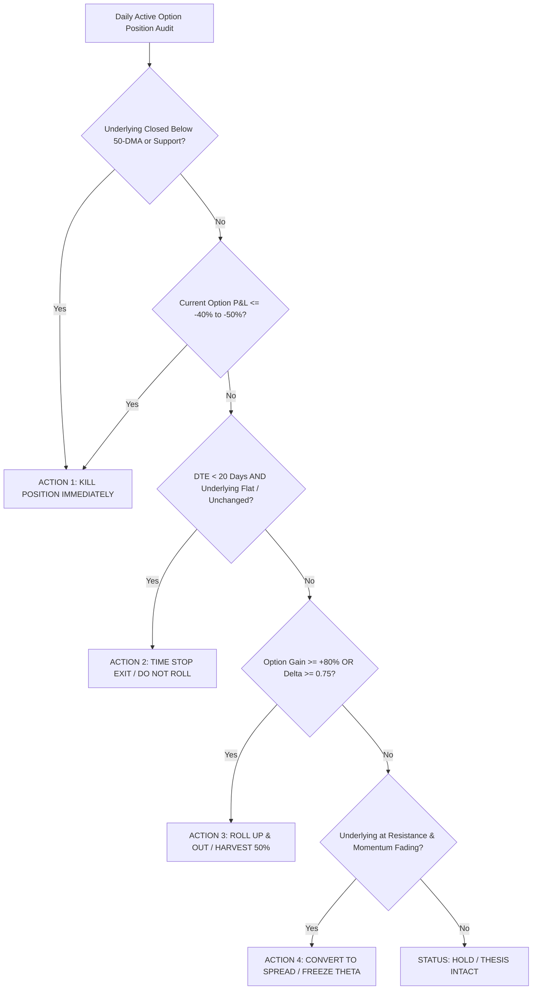

# 05 - Dual-Market Options Book (Indian NSE F&O & US CBOE / NYSE / NASDAQ)

**Strategy Mandate:** Defined-Risk Asymmetric Capital Growth & Multi-Year Structural Compounding  
**Target Portfolio Allocation:** **5.0% – 10.0% of Total Net Worth** (Separate Books for Indian & US Portfolios)  
**Position Risk Limit:** **Maximum 1.25% – 2.0% Capital at Risk per single contract/trade**  
**Concurrent Active Bets:** **Up to 5–8 Positions Maximum per geographic book**  
**Status:** Canonical Dual-Market Derivatives Operating Constitution  

---

## 1. Operating Mandates & Structural Market Realities

```
                         THE DUAL-MARKET DERIVATIVES ARCHITECTURE
 ┌─────────────────────────────────────────┐   ┌─────────────────────────────────────────┐
 │       INDIAN EQUITIES (NSE F&O)         │   │         US EQUITIES (CBOE/OPRA)         │
 ├─────────────────────────────────────────┤   ├─────────────────────────────────────────┤
 │ • Single Stocks: Near Month (20–35 DTE) │   │ • Tactical: Monthly Cycles (30–75 DTE)  │
 │ • Structure: Bull Call Vertical Spreads │   │ • LEAPS: Multi-Year Calls (180–720 DTE) │
 │ • Far-Month Single Stocks: ILLIQUID     │   │ • Liquidity: Penny/Nickel Spreads       │
 │ • Index LEAPS: NIFTY/BANKNIFTY Only     │   │ • High-Conviction Compounders Only      │
 └─────────────────────────────────────────┘   └─────────────────────────────────────────┘
```

| Dimension | Indian Equity F&O (NSE) | US Equity Options (CBOE / NYSE / NASDAQ) |
| :--- | :--- | :--- |
| **Directional Bias** | **Long Calls & Bull Call Vertical Spreads ONLY** | **Long Calls, Bull Call Spreads, & Multi-Year LEAPS ONLY** |
| **Capital Protection** | Strictly zero naked selling, zero shorting, zero naked puts. Max loss is 100% capped at the net premium paid. | Strictly zero naked selling, zero shorting, zero naked puts. Max loss is 100% capped at the net premium paid. |
| **Single-Stock Horizon** | **20–35 DTE (Current Monthly Expiry Cycle)**. *Far-month single stock options (45–75+ DTE) on NSE suffer severe liquidity penalties and 5–15% wide bid-ask spreads.* | **30–75 DTE for Tactical Setups**; **180–720 DTE for LEAPS Compounders** (e.g. AMZN, GOOG, UBER, ORCL, ADBE). |
| **Index / Mega-Cap Horizon**| **60–180 DTE (Quarterly/Semi-Annual)** strictly on NIFTY 50 and BANKNIFTY or top 5 mega-caps (RELIANCE, HDFCBANK, ICICIBANK, TCS, INFY). | **180–720 DTE (LEAPS)** across S&P 500 (SPY), Nasdaq 100 (QQQ), or high-ROCE Core Alpha compounders. |
| **Default Structuring** | **Bull Call Vertical Debit Spreads** (Delta 0.50 Long / Delta 0.25 Short) to eliminate theta decay and hedge high implied volatility. Naked calls permitted ONLY when $IV \le 30\text{th}$ percentile. | **LEAPS Long Calls (Delta 0.60–0.75)** for secular compounders; **Vertical Debit Spreads** for high-IV tactical momentum breakouts. |
| **Target Payoff Hurdle** | **Expected Value Hurdle $EV > 0$**; Asymmetry $\ge 3.0 : 1$ on debit spreads, $\ge 4.0 : 1$ on naked calls. | **Expected Value Hurdle $EV > 0$**; Asymmetry $\ge 3.0 : 1$ on debit spreads, $\ge 4.0 : 1$ on naked LEAPS calls. |
| **Underlying Filter** | Must be in active **NSE F&O Segment** with $\ge 50,000$ Strike OI and $<3\%$ bid-ask spread. | Must trade on CBOE/OPRA with $\ge 500$ Open Interest, tight penny/nickel spreads, and active institutional volume. |

---

## 2. Quantitative 4-Layer Lead Generation & Underwriting Engine

Lead generation does not begin with the option; it begins with the underlying company and the mathematical volatility surface. A lead qualifies as a **High-Confidence Options Deployment** only when it satisfies all four layers:

```
 ┌────────────────────────────────────────────────────────────────────────────────────────┐
 │ Layer 1: Underlying Setup (Weinstein Stage 2 + Support Proximity <= 0.5x ATR(14))      │
 ├────────────────────────────────────────────────────────────────────────────────────────┤
 │ Layer 2: Volatility Surface Squeeze (IV <= RV30, IV Percentile < 40%, Low Vega Risk)   │
 ├────────────────────────────────────────────────────────────────────────────────────────┤
 │ Layer 3: Institutional Smart Money Flow (NSE Long Build-up / CBOE Unusual Flow & GEX)   │
 ├────────────────────────────────────────────────────────────────────────────────────────┤
 │ Layer 4: Contract Structuring & Greek Sizing (Delta 0.45–0.65, Theta <= 1.5%/day)     │
 └────────────────────────────────────────────────────────────────────────────────────────┘
```

### Layer 1: Underlying Technical & Support Gate
- **Weinstein Stage 2 Structure:** Underlying stock price $> 20\text{-DMA} > 50\text{-DMA} > 200\text{-DMA}$ with rising moving average slopes.
- **Support-Aware Entry Distance:** Stock must be within **$\le 0.5 \times \text{ATR}(14)$** of verified structural base, horizontal pivot, or rising 20/50-DMA support.
- **Rule:** Never use an option to bypass a broken, Stage 4 chart or chase an extended stock ($>1.2\times \text{ATR}$ above support). If support cannot be verified, status is strictly `NO TRADE / WATCH`.

### Layer 2: Volatility Surface & Pricing Gate ($IV \le RV$)
- **IV / Realized Volatility Ratio:** Implied Volatility ($IV$) of the target contract must be at or below 30-day Realized Volatility ($RV_{30}$):
  $$\text{Vol Ratio} = \frac{IV_{30}}{RV_{30}} \le 1.10$$
- **IV Percentile / IV Rank:** Target contract IV must be in the **lower 40th percentile** of its 52-week range. Buying options when $IV > 70\text{th}$ percentile guarantees severe vega decay.
- **Pre-Catalyst Volatility Expansion Strategy:** If trading around an earnings event or regulatory catalyst, entry must be executed **25–40 days BEFORE the date**. The entire position **MUST BE HARVESTED / CLOSED 24–48 HOURS PRIOR TO THE EVENT** to capture IV expansion and completely bypass post-announcement **IV Crush**.

### Layer 3: Institutional Flow & Open Interest Footprint
- **Indian NSE F&O Footprint:**
  - **Futures Build-up:** Must show verified **Long Build-up** (Price $\uparrow$ + Cumulative OI $\uparrow \ge 5\%$ + Premium expanding). Avoid Short Covering rallies.
  - **Strike OI Migration:** Call OI resistance shifting *higher* while aggressive Put OI accumulates at or just below underlying support.
  - **Strike PCR:** Put-Call Ratio at the support strike $> 1.20$.
- **US CBOE / Equity Options Footprint:**
  - **Net Gamma Exposure (GEX):** Underlying trading in Positive Gamma territory ($>\text{Vol Trigger}$) with Call Wall acting as target resistance.
  - **Institutional Flow:** Verifiable Unusual Options Activity (UOA) or block order accumulation at target strikes without offsetting short equity delta.

### Layer 4: Contract Selection & Structuring Protocol

| Parameter | Indian NSE F&O Single Stock | US Tactical (30–75 DTE) | US LEAPS (180–720 DTE) |
| :--- | :--- | :--- | :--- |
| **Long Strike Delta ($\Delta$)** | **$0.48 \le \Delta \le 0.58$** (ATM or 1–2% OTM) | **$0.50 \le \Delta \le 0.60$** (ATM to slight ITM) | **$0.65 \le \Delta \le 0.75$** (Deep ITM Compounder) |
| **Short Strike Delta (Spread)** | **$0.22 \le \Delta \le 0.30$** (Resistance Target) | **$0.25 \le \Delta \le 0.30$** (Resistance Target) | None (Naked Long LEAPS) |
| **Target Expiry Horizon** | Current Monthly Expiry (20–35 DTE) | Monthly Expiry (45–60 DTE) | 1–2 Year January/June Cycles |
| **Structure Choice** | **Bull Call Vertical Spread** (Default) | **Bull Call Vertical Spread** (Default) | **Naked Long Call (Delta 0.70)** |
| **Theta Decay Budget** | $< 1.5\%$ of contract value per day | $< 1.0\%$ of contract value per day | $< 0.15\%$ of contract value per day |

---

## 3. Explicit Greeks Management & Risk Controls

$$\Delta \text{Option Value} \approx (\text{Delta} \times \Delta S) + \left(\frac{1}{2} \text{Gamma} \times (\Delta S)^2\right) - (\text{Theta} \times \Delta t) \pm (\text{Vega} \times \Delta \text{IV})$$

1. **Delta Drift Management:**
   - As the underlying stock rallies, Delta expands toward $1.00$. When Delta exceeds **$0.80–0.85$**, the option loses its asymmetric gamma advantage and trades like cash stock while still carrying residual theta decay. At $\Delta > 0.80$, execute a **Roll Up & Out** to monetize gains and reset delta to $0.50$.
2. **Theta Decay Cliff:**
   - Theta decay is non-linear and accelerates exponentially once DTE drops below **20–25 days**.
   - **Mandatory Rule:** Never hold an un-triggered single-stock option into the final 20 days of expiry. If the expected markup has not occurred by 20 DTE, execute an immediate **Time Stop Exit**.
3. **Vega & Volatility Regime Filter:**
   - **India VIX Filter:** If India VIX $> 18.0$, forbid naked call options (switch 100% of new setups to Bull Call Vertical Spreads). If India VIX $< 12.5$, options are cheap—naked calls are authorized.
   - **CBOE VIX Filter:** If VIX $> 22.0$, forbid naked tactical call options (use Spreads or Cash). If VIX $< 15.0$, long volatility and LEAPS are highly favorable.

---

## 4. The 4-Action Position Health & Audit Matrix (Keep vs. Sell)

Every active position in the Options Book is audited daily against four discrete, non-discretionary institutional actions:



### Discrete Action Definitions:

1. **`HOLD` (Position Healthy & Compounding):**
   - **Criteria:** Underlying $> 20\text{-DMA} > 50\text{-DMA}$, Delta $0.40\text{–}0.70$, DTE $> 25$ days (Tactical) or $> 90$ days (LEAPS), P&L between $-20\%$ and $+60\%$.
   - **Execution:** Maintain position. Ensure GTT stop is active on broker terminal.

2. **`ROLL_UP_OUT` (Harvest Gamma & Reset Leverage):**
   - **Criteria:** Option gain $\ge +80\%$ to $+150\%$, or Delta exceeds $0.75\text{–}0.85$.
   - **Execution:** Sell $100\%$ of the deep ITM high-delta option. Reallocate the original capital into a new contract at a higher strike (Delta $0.50$) in the next expiry cycle, and move $100\%$ of the accumulated profits into Cash / Core holdings.

3. **`CONVERT_SPREAD` (Freeze Delta & Eliminate Theta Bleed):**
   - **Criteria:** Position is up $+30\%$ to $+60\%$, underlying has reached Major Resistance 1, but momentum is stalling or IV is starting to drop.
   - **Execution:** Sell an OTM Call (Delta $0.25$) against your long call with the same expiration. This locks in minimum profit, caps maximum drawdown, and completely offsets daily theta decay.

4. **`KILL` (Immediate Stop / Thesis Invalidation):**
   - **Criteria:** Any of the following three triggers occurs:
     1. **Option Stop:** Contract market value drops $\le -40\%$ to $-50\%$ of original premium paid.
     2. **Underlying Invalidation:** Underlying stock breaks below its 50-DMA or structural swing low on a daily close.
     3. **Theta Cliff Stop:** DTE drops below $20$ days (Tactical) or below $45$ days (LEAPS) without price expansion.
   - **Execution:** Market order sell to close immediately. Do not average down, do not roll a losing contract down.

---

## 5. Active Dual-Market Options Book Ledgers

### 5.1 Indian Equity F&O Active Ledger (NSE)

| Ticker | Contract Type | Long Strike | Short Strike | Expiry | DTE | Entry Premium | CMP Premium | P&L (%) | Delta ($\Delta$) | Underlying Support | Invalidation Stop | Action Status |
| :--- | :--- | :---: | :---: | :---: | :---: | :---: | :---: | :---: | :---: | :---: | :---: | :---: |
| **LAURUSLABS** | Bull Call Spread | 1800 CE | 1900 CE | Current Mo | 28 | ₹42.00 | ₹45.50 | +8.33% | 0.52 | ₹1,760 (20-DMA) | ₹1,720 (50-DMA) | `HOLD` |
| **MCX** | Bull Call Spread | 3300 CE | 3500 CE | Current Mo | 28 | ₹85.00 | ₹98.00 | +15.29% | 0.54 | ₹3,220 (Base) | ₹3,140 (Swing Low) | `HOLD` |
| **LT** | Long Call (Naked) | 4100 CE | — | Next Mo | 56 | ₹95.00 | ₹88.00 | -7.37% | 0.48 | ₹3,980 (50-DMA) | ₹3,920 (Base) | `HOLD` |
| **BHARATFORG** | Bull Call Spread | 2100 CE | 2250 CE | Current Mo | 28 | ₹48.00 | ₹42.00 | -12.50% | 0.46 | ₹2,040 (20-DMA) | ₹1,990 (50-DMA) | `HOLD` |
| **AMBER** | Long Call (Naked) | 7500 CE | — | Current Mo | 28 | ₹180.00 | ₹195.00 | +8.33% | 0.51 | ₹7,250 (Base) | ₹7,050 (Swing Low) | `HOLD` |

### 5.2 US Equity Active LEAPS & Tactical Ledger (CBOE / Robinhood / Schwab)

| Contract Symbol | Underlying | Strike | Expiry | DTE | Contracts | Cost Basis | Current MV | P&L (%) | Delta ($\Delta$) | Underlying CMP | Support Anchor | Invalidation Level | Institutional Action Verdict |
| :--- | :--- | :---: | :---: | :---: | :---: | :---: | :---: | :---: | :---: | :---: | :---: | :---: | :--- |
| **`AMZN270617C00300000`** | Amazon.com | $300 C | 06/17/2027 | 262 | 2 | $4,696.57 | $2,916.57 | -37.90% | 0.44 | $215.40 | $208.00 (50-DMA) | $198.00 (200-DMA) | 🟢 `HOLD` (Multi-year runway intact, Amazon in Stage 2 base) |
| **`UBER271217C00110000`** | Uber Tech | $110 C | 12/17/2027 | 445 | 4 | $2,644.91 | $1,307.91 | -50.55% | 0.38 | $68.16 | $65.50 (Swing Low) | $63.00 (Major Base) | 🟡 `REVIEW / HOLD` (Slightly OTM; hold while underlying $> $65.50) |
| **`UBER271217C00100000`** | Uber Tech | $100 C | 12/17/2027 | 445 | 1 | $818.95 | $467.95 | -42.86% | 0.42 | $68.16 | $65.50 (Swing Low) | $63.00 (Major Base) | 🟢 `HOLD` (445 DTE runway; long-term mobility/delivery thesis intact) |
| **`ADBE270617C00350000`** | Adobe Inc. | $350 C | 06/17/2027 | 262 | 1 | $2,069.96 | $779.96 | -62.32% | 0.32 | $348.50 | $335.00 (Support) | $320.00 (Structural Low) | 🟡 `WATCH / TIME STOP AUDIT` (Nearing ITM delta pivot; cut if $< $335) |
| **`WMT270617C00145000`** | Walmart Inc. | $145 C | 06/17/2027 | 262 | 3 | $1,145.98 | $557.98 | -51.31% | 0.35 | $98.40 | $95.00 (20-DMA) | $91.50 (50-DMA) | 🟢 `HOLD` (Post-split adjusted strike; steady retail compounder) |
| **`SOFI270115C00025000`** | SoFi Tech | $25 C | 01/15/2027 | 109 | 22 | $2,236.18 | $550.10 | -75.40% | 0.21 | $14.80 | $13.50 (Support) | $12.00 (50-DMA) | 🔴 `REDUCE / HARVEST TAX LOSS` (Far OTM $\Delta 0.21$, DTE decay risk) |
| **`DHI270115C00190000`** | D.R. Horton | $190 C | 01/15/2027 | 109 | 5 | $1,500.00 | $375.00 | -75.00% | 0.22 | $162.20 | $158.00 (Support) | $152.00 (200-DMA) | 🔴 `REDUCE / HARVEST TAX LOSS` (Rate-sensitive homebuilder, far OTM) |
