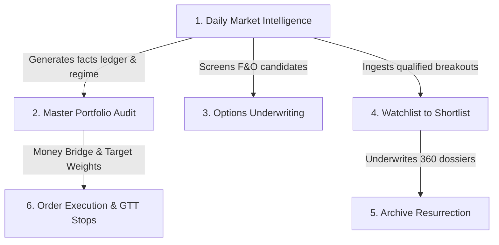

# Institutional Portfolio Operating System & Research Engine

An institutional-grade, multi-market quantitative equity research, portfolio forensic audit, and automated intelligence operating system. Built for dual-market multi-custody wealth management:

- **🇮🇳 Indian Equities Portfolio (NSE/BSE):** Demat custody via Zerodha (`sheets/Zerodha_Holdings.xlsx`), benchmarked against Nifty 50 and Nifty 500, with options gamma radar and capacity-constrained shortlist/watchlists.
- **🇺🇸 US Equities Portfolio (NYSE/NASDAQ):** Multi-broker custodial consolidation across Charles Schwab, Robinhood, and tactical LEAPS options (`sheets/US_Portfolio_Holdings.xlsx`), benchmarked against S&P 500, Nasdaq-100, Russell 2000, and CBOE VIX.

All research deliverables, daily briefings, and 238+ equity dossiers are automatically published as static web pages to **GitHub Pages** via the `docs/` directory.

---

## 1. Architecture & Folder Structure

```
portfolio/
├── docs/                                  # 🌐 GitHub Pages Root (Public Web Portal)
│   ├── index.html                         # Master Institutional Research Portal & Command Deck
│   ├── .nojekyll                          # Bypasses Jekyll processing on GitHub Pages
│   ├── README.md                          # Portal architecture and publishing notes
│   ├── reports/                           # 📊 Institutional Daily Briefings & Portfolio Audits
│   │   ├── Daily_Market_Intelligence_*.html   # Indian Daily Intelligence Briefings
│   │   ├── US_Market_Intelligence_*.html      # US Daily Intelligence Briefings
│   │   ├── Portfolio_Audit_*.html             # Indian Demat Forensic Portfolio Audits
│   │   ├── US_Portfolio_Audit_*.html          # US Brokerage Forensic Portfolio Audits
│   │   └── Options_Underwriting_*.html        # Quantitative Derivatives Position Audits
│   └── blogs/                             # 📑 238+ Encyclopedic Company Research Dossiers
│       ├── <SYMBOL>_dossier.html          # Individual self-contained HTML research dossiers
│       ├── dossiers.json                  # Shared multi-factor registry (238 companies)
│       ├── dossier_nav.js                 # Sticky client-side research navigator
│       └── index.html                     # Research library index
├── sheets/                                # 📁 Private custody holdings & account notes (gitignored)
│   ├── Zerodha_Holdings.xlsx              # Indian active Demat holdings
│   ├── US_Portfolio_Holdings.xlsx         # US consolidated brokerage holdings
│   ├── Options_Positions.xlsx             # Active derivative positions
│   ├── charles_schwab.md                  # Schwab account balances and tax lots
│   └── robinhood_current_holdings.md      # Robinhood account balances
├── watchlist/                             # 📁 Active & rejected watchlists (gitignored)
│   ├── Zerodha_Watchlist.xlsx             # Indian candidate watchlist (Active & Archive_Rejected)
│   └── US_Portfolio_Watchlist.xlsx        # US candidate watchlist (Active & Archive_Rejected)
├── shortlist/                             # 📁 Capacity-constrained shortlists (gitignored)
│   ├── Zerodha_Shortlist.xlsx             # Indian Master Shortlist (10 Core Alpha + 10 Tactical)
│   └── US_Shortlist.xlsx                  # US Master Shortlist (10 Core + 10 Tactical + 5 Satellite)
├── transcripts/                           # 📁 Fund manager calls, investor transcripts & research notes
├── scripts/                               # ⚙️ Permanent Python infrastructure & tools
│   ├── market_facts.py                    # Zero-bias exchange data fetcher & ledger builder
│   ├── validate_report.py                 # Deterministic pre-send quality & quantitative floor gate
│   ├── send_email.py                      # Gmail SMTP dispatch engine
│   ├── build_dossier_portal.py            # Master portal index & dossiers.json compiler
│   ├── serve_blogs.py                     # Local preview server (http://localhost:9050)
│   └── config/aliases.json                # Broker symbol to Yahoo Finance ticker mappings
└── .agents/                               # 🤖 Autonomous agent workflows, skills, and configurations
    ├── workflows/                         # Parameterized workflows (market_intelligence, portfolio_audit, etc.)
    ├── skills/                            # Encyclopedic skill specifications (Blueprint 7A, 7B, etc.)
    └── config/                            # Runtime parameters (markets.json, portfolios.json, reviewer.json)
```

---

## 2. Implicit Operational Expectations & Workflow Ordering

Executing reports requires adhering to specific dependency constraints between workflows:



### Mandatory Execution Sequence:
1. **Market Intelligence Runs FIRST:**
   - Execute `market_intelligence.md` (`IN` or `US`) immediately after market close.
   - Computes moving averages, Wilder RSI(14), ATR(14), Stage 1–4 Weinstein stages, and screen picks (30 Breakouts, 30 Breakdowns).
   - Establishes the authoritative `regime.label` (e.g. `Downtrend`, `Uptrend (broad)`) and market breadth.
2. **Portfolio Audit Runs SECOND:**
   - Execute `portfolio_audit.md` (`IN` or `US`) **only after** Market Intelligence has run for that session date.
   - **Implicit Coherence Rule:** The portfolio audit strictly reconciles against the market intelligence regime and ledger closes for the exact same session. Tickers appearing in both reports must carry identical prices, moving averages, and stages.
3. **Options Underwriting Runs THIRD:**
   - Audits active contracts against the 4-action matrix (`HOLD`, `ROLL_UP_OUT`, `CONVERT_SPREAD`, `KILL`) and evaluates new high-conviction IV/RV squeeze setups.
4. **Watchlist Underwriting Runs Concurrently or In Batches:**
   - Takes candidates from `Active_Watchlist`, runs 360-degree fundamental underwriting, generates `docs/blogs/<SYMBOL>_dossier.html`, and enforces capacity caps in `shortlist/` using displacement economics.

---

## 3. Data Integrity & Ledger Architecture

### Single Source of Truth
No prices, moving averages, RSI values, volume multiples, or regime labels may ever be quoted from memory or estimated:
- Built fresh from scratch via `python3 scripts/market_facts.py --market <MKT> --date <YYYY-MM-DD> --screen <universe> --run-dir "<RUN_DIR>"`.
- Fetches official daily exchange bars (NSE/BSE or NYSE/NASDAQ) via `yfinance`.
- Calculates arithmetic SMAs (20, 50, 200) and Wilder's exponential moving average for RSI(14) and ATR(14).

### Per-Symbol Freshness Check
Every facts ledger and run manifest records the exact timestamp and `asof_bar` date for every instrument:
- If any active holding has not updated to the target session date's close, `market_facts.py` blocks execution by default with `HOLDINGS NOT CURRENT`.
- Guarantees zero stale valuations during capital reallocation audits.

### Flexible Ingestion for Multi-Broker Spreadsheets
Custodial workbooks from different brokers (Zerodha, Charles Schwab, Robinhood) frequently use varied header casing and naming conventions:
- Ingestion dynamically searches for ticker columns case-insensitively across aliases (`SYMBOL`, `TICKER`, `STOCK`, `INSTRUMENT`, `COMPANY`).
- Prevents script breakage when brokers update export formats.

### Up-Front Targeted Web Research Pass
Data not obtainable from daily price bars (provisional institutional net flows, options open interest walls, bulk deals, earnings dates) is gathered up-front:
- Uses live search tools before narrative drafting begins.
- **Dual-Source Verification:** Institutional cash flows (`fii_dii_cash`) and index options walls (`nifty_options` / `spx_options`) must cite two independent URLs.
- Results are frozen in `<RUN_DIR>/cache/research_<MKT>_<date>.json`.

---

## 4. Token & Run Efficiency: Section Drafting Against Fact Packs

Generating 11,000–16,000 word encyclopedic research documents within LLM context windows without dilution or truncation:
- **The Fact Pack:** `market_facts.py` compiles a compact, focused subset of the ledger (`factpack_<MKT>_<date>.json`).
- **Section Slicing:** Long briefings are drafted in independent section passes against the fixed fact pack and research records.
- **Benefits:**
  - Prevents context compression and hallucinated metrics.
  - Ensures each chapter meets its mandatory prose floor (600+ words per H2) and scaffolding rules.
  - Significantly reduces API token costs and prevents run timeouts.

---

## 5. Quality Gates & Deterministic Validation

### 1. Pre-Send Deterministic Validation Gate (`scripts/validate_report.py`)
Every report must pass automated programmatic validation before delivery or publishing:
- **Total Prose Floor:** $\ge 9,000$ words (target: 11,000–16,000 words).
- **Section Prose Floors:** Every H2 section must have $\ge 600$ words of explanatory prose.
- **Pedagogical Scaffolding (Blueprint 7A):**
  - `<div class="primer">`: $\ge 450$ words defining core market mechanics with everyday analogies.
  - Reading guides (`<div class="howto">`): $\ge 50$ words before every data table.
  - Empirical takeaways (`<p class="takeaway">`): $\ge 120$ words after every data table naming specific levels.
  - Minimum 12 case notes (`<div class="casenote">`), each $\ge 80$ words with explicit mathematical triggers.
  - Minimum 1 worked numeric example (`<div class="example">`) showing position sizing arithmetic.
  - Minimum 6 trigger blocks (`<div class="triggers">`) defining invalidation thresholds.
- **Zero Omissions:** Full 30 breakout and 30 breakdown alerts populated with no placeholder comments.
- **Price Fidelity:** Closing prices must match the ledger within 1.5% tolerance.
- **Zero Placeholder N/As:** N/A budget $\le 5.0\%$ overall, $\le 25\%$ in any table.

### 2. Independent Reviewer Gate (`report_reviewer`)
An independent verification gate evaluates the finished report across three passes:
- **Source Pass:** Spot-checks at least 10 numbers and citations against the ledger and research files.
- **Consistency Pass:** Verifies that regime labels, prices, stages, and verdicts are uniform across all chapters.
- **Tone Pass:** Confirms accessible, educational, beginner-friendly explanations with no banned buzzwords.

---

## 6. Delivery, Single-Latest Versioning & GitHub Pages

### Single-Latest in Working Tree vs Git History
- **Working Tree:** `docs/reports/` maintains strictly only the single latest report for each briefing type (e.g., `Daily_Market_Intelligence_<YYYY-MM-DD>.html`).
- **Clean Portal:** Prevents the public GitHub Pages research portal from becoming cluttered with stale daily reports.
- **Historical Preservation:** Every prior version is permanently preserved in the repository's Git commit history. To view historical briefs from previous sessions, simply inspect past commits (`git log docs/reports/`).

### Publishing to GitHub Pages
1. The report HTML is saved to `docs/reports/`.
2. `scripts/build_dossier_portal.py` rebuilds `docs/index.html` (linking to the latest briefings) and `docs/blogs/index.html`.
3. Committing and pushing `main` to the remote repository immediately updates the live GitHub Pages website.

---

## 7. Permanent Infrastructure & Workspace Hygiene

### Whitelisted Scripts (Never Delete)
The following scripts form the permanent infrastructure of this system:
- `scripts/market_facts.py` — Exchange data ingestion and ledger generation.
- `scripts/validate_report.py` — Deterministic report validation engine.
- `scripts/send_email.py` — Gmail SMTP briefing dispatcher.
- `scripts/build_dossier_portal.py` — Research portal and registry compiler.
- `scripts/serve_blogs.py` — Local HTTP server for reviewing dossiers and reports (`localhost:9050`).
- `scripts/dossier_builder_template.py` — Template builder for company dossiers.
- `scripts/config/aliases.json` — Symbol alias mappings.

### Cleanup Protocol
- All temporary generator code, scrape dumps, and draft JSON files must be created strictly within `<RUN_DIR>/work/`.
- Upon successful validation and delivery, the temporary directory is deleted (`rm -rf "<RUN_DIR>"`).
- Permanent scripts in `scripts/` are never deleted during post-run cleanup.

---

## 8. Quickstart Commands

```bash
# 1. Preview Research Portal locally on port 9050
python3 scripts/serve_blogs.py

# 2. Rebuild Master Portal Index & Dossier Registry
python3 scripts/build_dossier_portal.py

# 3. Build Facts Ledger from Scratch for a Session Date
python3 scripts/market_facts.py --market IN --date 2026-10-07 --screen nifty500 --run-dir "/tmp/run-in"

# 4. Validate an HTML Report Deterministically
python3 scripts/validate_report.py \
  --report "docs/reports/Daily_Market_Intelligence_2026-10-07.html" \
  --kind market_intel \
  --facts "/tmp/run-in/cache/facts_IN_2026-10-07.json"

# 5. Dispatch Briefing via Gmail SMTP
python3 scripts/send_email.py \
  --subject "📊 Daily Market Pulse | 2026-10-07" \
  --html-file "docs/reports/Daily_Market_Intelligence_2026-10-07.html" \
  --recipient "rajasekharreddymekala732@gmail.com"
```
